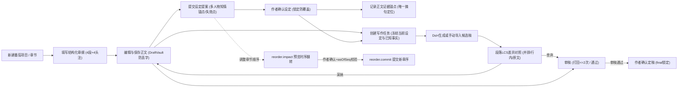
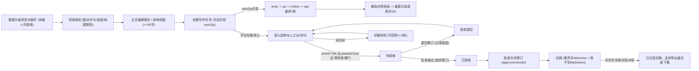

# 01 · 产品全景与业务工作流

本文档回答 **「织章 V2 到底是什么、解决什么问题、完整的使用流程是什么」**，并与 [领域规则与共享契约](./02-domain-rules.md) 及 [系统架构与接口手册](./03-architecture.md) 配合阅读。

---

## 一、项目定位与解决的痛点

在 AI 辅助长篇小说连载与自媒体图文创作场景中，通用对话式 AI 工具存在三类结构性问题：

1. **原稿主权失守**：模型输出直接覆盖工作稿，或未经作者核准便写入定稿/发布状态，作者难以分清「自己写的文字」「模型建议的文字」与「已经批准的版本」。
2. **长篇设定时间线失控**：连载几十上百章后，角色在不同章节、不同段落对同一秘密的知情范围不同；调整章节顺序或新增设定后，容易出现人物提前泄密、前后设定冲突、旧有设定被悄悄覆盖。
3. **图文返工与用量黑盒**：头条类图文需同时兼顾体裁字数、内容线结构、34 字标题限制与多轮质检，缺乏硬门校验和自动回改上限控制；长文本生成过程中一旦网络中断或超时，往往无法追查已消耗的令牌或安全恢复。

**织章 V2.2（`@zhizhang/dsh-workbench` `v2.2.0`）** 作为 DeepSeek Harness（DsH Web `0.2.2+`）的本地作者工作台插件，在完整保留三态隔离、作者主权与人物知情时间线的基础上，新增控制面与滚动规划、标准 `SKILL.md` 方法论沙箱、零 Token 黄金三章/AI 味体检与定性 `Observation` 审稿、SHA-256 `fact_sync` 记忆闭环、逐段字级 Diff/选段微改写、书斋冷启动与三套纸面主题，以及 DsH 7 只读 + 3 提案型对话工具协同。

---

## 二、三大核心产品原则

### 1. 作者主权（Author Authority）
- 依据 [src/contracts/commands.ts](../src/contracts/commands.ts) 与 `test/authority-a01.test.mjs`，**全部 7 个权威写命令**（`draft.save`、`run.start`、`candidate.adopt`、`draft.finalize`、`setting.decide`、`article.accept`、`article.deliver`）以及审批决策（`approval.decide`）仅允许 `author` 执行。
- 写作模型（`agent`）只负责在给定冻结输入下产出候选稿（`candidate.produce`），对权威正文、设定库、流转状态与交稿表**无任何直接写入路径**。

### 2. 三态文本严格分离
在任何时刻，同一篇稿件的三类文本处于不同的数据表与生命周期中：
- **工作稿修订（`revisions`）**：作者主动保存（`draft.save`）、采纳候选（`candidate.adopt`）、改题（`article.rename`）或手动保存回改稿（`article.refine`）生成只增不改的修订链，由 `documents.current_revision_id` 指向当前工作修订。
- **模型候选稿（`candidates`）**：生成任务产出的文本绑定 `base_revision_id` 独立存放在 `candidates` 表；在工作台「候选稿差异对照」区展示并排 / 行内 / 原文对照，**只有作者点击采纳且当前基准修订未漂移时**才会转为新的工作修订。
- **定稿 / 获批交稿版本（`final_revision_id` / `deliveries`）**：番茄章节经审稿通过并定稿（`final`）、头条文章经作者验收（`已验收`）并版本绑定批准（`author_approvals`）后，方可进入交稿导出（`deliveries` + 本地 `.md` 文件）。

### 3. 零工具一次传输与全链路可审计
- **无会话工具**：`src/host/writing.ts` 的 `generateCandidate` 每次调用模型只传入 `system` 与单轮 `messages`（`user` 文本），绝不传递 `tools` 或 Agent 会话上下文。
- **全量账本与事件流**：每次生成尝试和子阶段调用记录在 `author_generation_attempts` 与 `author_generation_calls`，所有项目写操作同步写入只增事件流 `event_log`，供 6 个只读模型增量回放。

---

## 三、两大产品线端到端工作流

两条产品线在同一个工作台 UI 中共用项目目录、编辑区、防丢字草稿保险箱、差异对照器与生成任务面板，但在领域规则、流程面板标签页与服务层保持完全独立。

### 1. 番茄连载闭环（Fanqie）

番茄连载围绕 **「章节推进 × 叙事锚点 × 人物知情边界」** 展开：

**关键作者体验设计**：
- **同一事实多版本与逆序批准**：即使作者先批了后提的提案、再批了早提的提案，直接查询（`settings.read`）、事件回放（`read.model`）与生成冻结输入（`freezeWriting`）三处均按 `decided_seq` 与生效锚点给出完全一致的当前有效设定。
- **任意章段查人物所知**：作者在「设定」页签指定人物与段落号，即可即时查询该角色在该章该段「已经知道哪些已确认设定」，防止前文未交代信息提前泄露。
- **章序调整安全网**：点击「上移本章 / 下移本章」时，系统先计算所有已确认设定的有效期与知情时序是否因章序变化而翻转，并在自定义模态框逐条列出受影响的设定编号与关系标签，经作者确认后才提交。

---

### 2. 头条创作闭环（Toutiao）

头条创作围绕 **「体裁内容线矩阵 × 标题规范 × 84 分 QA 门 × 版本绑定交稿」** 展开：

**关键作者体验设计**：
- **长中文稿前置预算核算**：作者在发起任务前可点击「按当前修订核算」（`run.preview`），系统按实际冻结输入（正文、规划、场景规则、指令）精确测算保守输入预留与建议总额，避免正常 3,000 字长图文未调模型就预算耗尽。
- **改题不污染已批记录**：非微头条支持在编辑器上方直接修改标题或套用「标题候选矩阵」中的方案；改题生成新修订并流转回 `初稿待改`，原修订的 QA 报告和批准记录仍严格绑定于旧修订号。
- **交稿与导出分离**：即使本地磁盘目录暂时不可写或存在同名异内容文件（`export.conflict`），数据库中的 `已交稿` 状态与批准记录仍安全提交；作者可通过页面按钮直接下载获批 Markdown，或在清理文件冲突后点击「重试或检查导出」，重启插件时也会自动补偿待导出记录。

---

## 四、明确的非目标与系统边界

依据 [AGENTS.md](../AGENTS.md) 与当前实现，织章 V2 明确**不做**以下事项：

1. **不兼容 v1.x Electron 应用与旧盘格式**：不引入 Pi SDK、不迁移 v1.x 磁盘文件或老接口，存储打开严格校验 `zhizhang/2.x` Schema 窗口。
2. **不自动对外网平台发文**：交稿产物仅为本地 `DSH_HOME/zhizhang-v2/deliveries/<documentId>.md`（及浏览器下载），是否采用、何时发布完全由作者决定。
3. **不固化易变的平台条款**：创作者平台规范以当期官方后台为准，不作为静态代码门禁冻结。
4. **不代替 DsH 计算货币费用**：织章记录 4 类真实令牌用量（`input`、`output`、`cache_read`、`cache_write`），模型费率与计费策略留给 DsH 提供方；若发生中断且用量未回执，必须等待作者查询 DsH 账单后手动核对（`run.reconcile`），绝不自行估算填充。
5. **不依赖远程服务与第三方运行时包**：全栈仅使用 Node.js 24 原生能力与 `node:sqlite`，工作台所有弹窗均使用原生 `<dialog>` 实现，避免在 DsH 严格沙箱 iframe 中因 `window.confirm` / `prompt` 失效。
