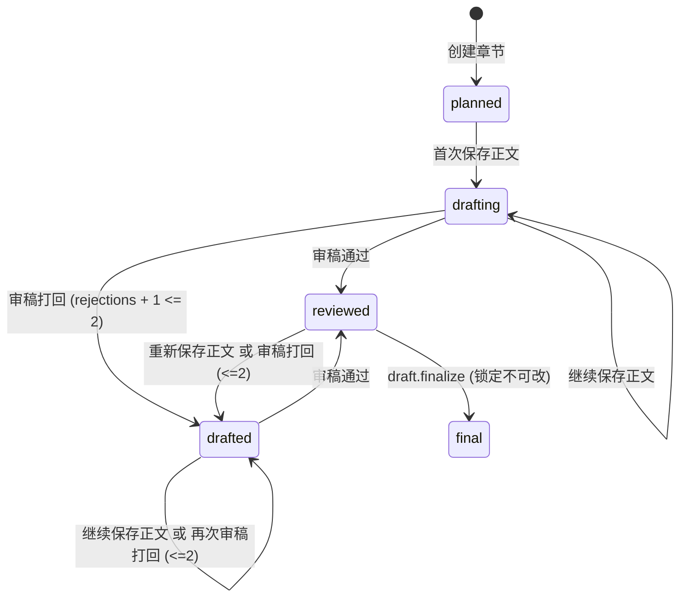
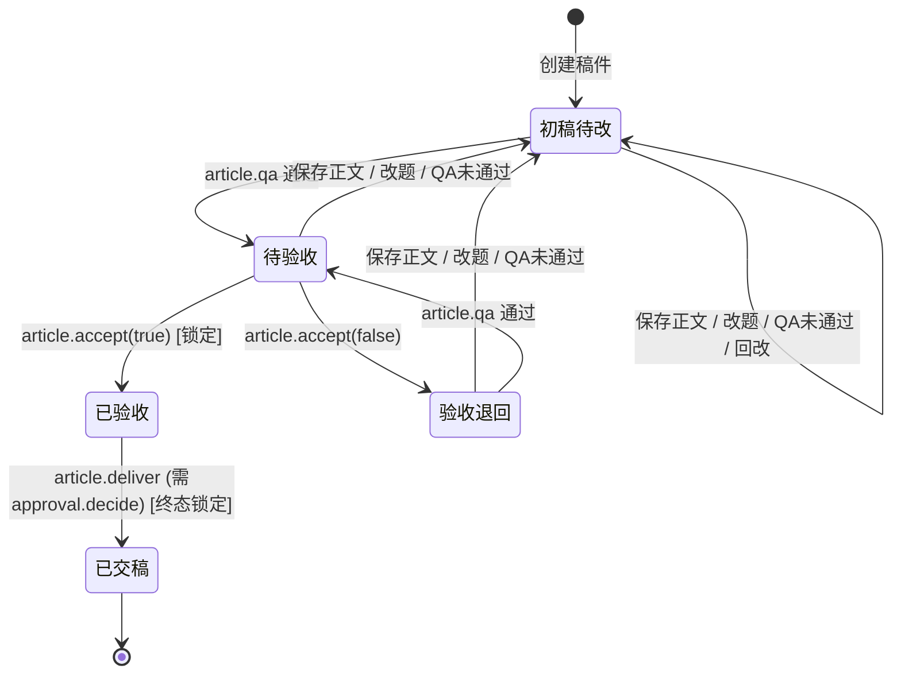

# 02 · 领域规则与共享契约

本文档逐条梳理受保护的业务规则、双产品线状态机及共享冻结契约。所有数值、词表和流转规则均直接对应 `src/contracts/` 与 `src/domain/` 源码；**未经作者显式授权，不得擅自放宽、收窄或重定义其中任何受保护语义**。

---

## 一、番茄连载领域规则

对应源码：[src/domain/shared/anchors.ts](../src/domain/shared/anchors.ts)、[src/domain/fanqie/editorial.ts](../src/domain/fanqie/editorial.ts)、[src/domain/fanqie/reorder.ts](../src/domain/fanqie/reorder.ts)、[src/application/products/fanqie.ts](../src/application/products/fanqie.ts)。

### 1. 章节状态机与审稿定稿门

章节共有 5 个封闭状态词（`CHAPTER_STATES`），与运行态词表完全互斥：



| 规则项 | 源码常量 / 函数 | 精确约束 |
| --- | --- | --- |
| 章节状态词表 | `CHAPTER_STATES` | `planned`（待写）、`drafting`（写作中）、`drafted`（已有草稿）、`reviewed`（已审稿）、`final`（已定稿） |
| 审稿打回上限 | `EDITORIAL_REJECTION_LIMIT = 2` | 当 `editorialRejections >= 2` 时，`chapter.review` 拒绝继续打回（`gate.denied` / `editorial-rejection-limit`） |
| 定稿门控 | `assertChapterFinalizable` | 仅当 `state === "reviewed"` 且 `editorialRejections <= 2` 时允许 `draft.finalize`；定稿后写入 `final_revision_id` 并锁定正文 |
| 默认章幅与提醒带 | `DEFAULT_CHAPTER_LENGTH` / `CHAPTER_LENGTH_WARNING_BAND` | 默认建议 `[2000, 2500]`；提醒区间 `[1500, 6000]`（按 Unicode 非空白字符计数；超出仅返回提醒 `warnings`，不阻断保存章纲） |
| 节奏三档（软建议） | `PACING` | `快爽`（逆袭/打脸/系统/鉴宝/高武/战神/重生）、`稳推`（权谋/经营/种田/年代/都市/都市日常/言情）、`慢燃`（悬疑/灵异/刑侦/温情/群像） |
| 四段式章纲 | `OUTLINE_SECTIONS` | 必填 4 块：`剧情梗概`、`核心冲突与看点`、`情节推进节点`、`章末落点`；另加 4 头注：`viewpoint`、`target`（正整数）、`lockedFacts`、`knowledge` |

### 2. 叙事锚点、半开区间与人物知情过滤

- **叙事锚点 `Anchor`**：`{ chapterId: string, point: number }`（`point >= 1` 为章内段序）。锚点不存字符偏移，从而免疫正文增删改。
- **章序位置 `orderIndex(chapterId, chapterOrder)`**：在当前章序数组中的下标；**未出现在章序中的章节统一排在所有已知章之后**（下标为 `chapterOrder.length`），同未知组内回退比较 `point`。
- **半开有效区间 `isEffective`**：`[effectiveFrom, effectiveTo)`，即 `!precedes(at, effectiveFrom, order)` 且若存在 `effectiveTo` 则必须满足 `precedes(at, effectiveTo, order)`。到达失效锚点本身时已**不再有效**；提案阶段若 `effectiveTo` 不晚于 `effectiveFrom`，直接报 `input.invalid`（`empty-validity-interval`）。
- **多版本裁决与人物知情过滤 `settingsAt`**：
  1. 数据库按 `decision = 'approved'` 且 `ORDER BY decided_seq ASC, sequence ASC` 读取所有已批准设定；
  2. 过滤出在当前锚点 `at` 处于 `[effectiveFrom, effectiveTo)` 区间内的记录；
  3. 对同一 `fact.id` 存在多个有效版本时，取生效点不早于前一个版本（`!before(entry.effectiveFrom, prior.effectiveFrom)`）的最新批准记录；
  4. 过滤掉 `kind === "agreement"` 的约定条目（用户约定单独归档，不混入人物知情事实）；
  5. 仅当 `Object.hasOwn(entry.knownFrom, characterId)` 且 `!before(at, entry.knownFrom[characterId])` 时返回给该人物。
- **锁定设定不可覆盖**：若 `author_settings` 中已存在同 `fact_id` 且 `locked: true` 的已批准条目，后续 `setting.decide` 尝试批准同 `fact_id` 新提案时抛出 `gate.denied`（`setting-is-locked`）。

### 3. 章序重排两步协议 & 正文证据锚点

- **章序重排两步协议（`reorder.impact` → `reorder.commit`）**：
  1. 提案新顺序必须精确包含当前项目全部章节各一次；
  2. `reorder.impact`（只读）遍历所有已批准设定的两类时序关系——`设定有效期`（`effectiveFrom → effectiveTo`）与各角色 `{character}知晓`（`effectiveFrom → knownFrom[character]`），利用 `reorderImpact` 计算前后相对顺序发生翻转的关系列表及当前项目水印 `asOfSeq`；
  3. `reorder.commit`（写入）校验传入 `asOfSeq === currentSeq`（否则报 `version.conflict`）且 `confirmed === true`（否则报 `gate.denied`）。
- **正文证据锚点（`evidence.record`）**：要求传入当前 `baseRevisionId` 且摘句 `quote` 在已保存正文 `body` 中**恰好出现 1 次**（0 次或 ≥2 次均拒为 `input.invalid` / `quote-must-match-exactly-once`），计算首行至匹配位置的段号 `point` 与 UTF-16 起止下标 `quote_start`/`quote_end` 存入 `author_evidence` 并写 `evidence.recorded` 事件。

---

## 二、头条创作领域规则

对应源码：[src/domain/toutiao/index.ts](../src/domain/toutiao/index.ts)、[src/domain/toutiao/refinement.ts](../src/domain/toutiao/refinement.ts)、[src/application/products/toutiao.ts](../src/application/products/toutiao.ts)。

### 1. 文章状态机

头条文章共有 5 个封闭状态词，同样与运行态词表完全互斥：



> 锁定状态集合 `WORKSPACE_LOCKED_STATES`（包含番茄与头条）：`["final", "已验收", "已交稿"]`。处于锁定态后禁止保存正文、改题、提交 QA 或发起写作任务。

### 2. 六格场景矩阵（体裁 × 内容线）

由 `articleScenario(mode, line)` 组合 `ARTICLE_MODES` 与 `CONTENT_LINES` 得出，缺一或非法均抛 `input.invalid`：

| 体裁 (`mode`) | 中文标签 | 正文非空白字数区间 | 主文 / 延伸分段建议 | 是否设标题 |
| --- | --- | --- | --- | --- |
| `long` | 长图文 | `2,600 – 3,400` | 主文 `1,700–2,300` / 延伸 `800–1,300` | 是（`hasTitle = true`） |
| `short` | 短图文 | `1,100 – 2,200` | 无强制分段 | 是（`hasTitle = true`） |
| `micro` | 微头条 | `300 – 1,000` | 无强制分段 | **否（`hasTitle = false`）** |

| 内容线 (`line`) | 驱动 (`drivers`) | 开头 (`openings`) | 结尾 (`endings`) | 延伸 (`extensions`) |
| --- | --- | --- | --- | --- |
| `资讯线` | 账本型、处境型、冲突型、信息型、情感型 | 现场动作、跑腿卡点、原话顶门、时间死线、直球亮底牌、账单暴击 | 经历共鸣、两难选择、潜台词追问、帮亲友问计、观点碰撞、晒坐标 | 下一步、另一面、往深一层 |
| `故事线` | 故事型 | 定格画面、原典一句、反常结局、配角开口、直球亮底牌 | 画面留白、两难选择、经历共鸣、观点碰撞、古今对照 | 别国同母题、原典与流行说法、今天的痕迹 |

### 3. 标题矩阵、结构门与 QA / 回改 / 交稿门

| 规则项 | 源码常量 / 函数 | 精确约束 |
| --- | --- | --- |
| **标题字符上限** | `TITLE_MAX = 34` | 按 `[...title.trim()].length` **Unicode 码点**计数（正确处理辅助平面字符如 `𠮷`、`🔥`），1–34 字符；微头条禁填标题 |
| **标题候选矩阵** | `validateTitleMatrix` | 规划中填写每行 `标题文本 \| 母题`，过滤空项、超 34 码点项、无母题项并按标题去重后，须满足 **`valid.length >= 5` 且 `motifCount >= 3`** |
| **结构门禁** | `structuralGates` | 1) `micro`：不能有标题，正文不能含 Markdown `#{1,6}` 小标题行；2) `long`/`short`：标题须 1–34 码点；3) 全模式：非空白 Unicode 字符数须落在对应 `ARTICLE_MODES[mode].length` 区间内 |
| **原地改题** | `article.rename` | 仅非微头条且未锁定时可用；若标题变化，更新标题并追加一条新修订（原正文不变），状态回到 `初稿待改`；旧修订的 QA 与批准记录仍归原修订 |
| **QA 通过线** | `QA_PASS_SCORE = 84` / `qaPassed` | 须同时满足：`overall` 在 `[84, 100]` 合法数、`passed === true`、`fails.length === 0`、`hardGates.length === 0`（自动合并 `structuralGates` 计算结果） |
| **回改轮次上限** | `QA_REFINEMENT_LIMIT = 2` / `refineArticle` | 无论手动 `article.refine`（`author_documents.qa_rounds < 2`）还是模型自动回改（`author_run_refinement_claims` 持久化），上限均为 **2 轮**；每轮回改后必重新执行 QA 评估 |
| **交稿固定尾句** | `DELIVERY_ENDING` / `formatDelivery` | 固定尾句：`——AI 到此止步。是否采用、何时发布由你决定。`；`formatDelivery` 先循环剥离末尾已有的重复尾句，再按 `[# 标题, 正文, DELIVERY_ENDING]` 以空行拼接并保证只输出一次 |

---

## 三、共享冻结契约（`src/contracts/`）

### 1. 封闭错误码信封（`src/contracts/errors.ts`）

所有模块均抛出 `ContractError`（或存储层子类 `StorageError`），其错误码严格限定在以下 **11 个封闭成员**内，超出集合构造时直接报错；返回调用方时通过 `toEnvelope()` 生成 `{ code, details, diagnosticId }`（`diagnosticId` 为每次新生成的 UUID）：

| 错误码 (`ERROR_CODES`) | 语义说明 | HTTP 状态码 (`plugin.ts`) |
| --- | --- | :---: |
| `input.not_found` | 项目、文档、任务、设定提案、候选或交稿记录不存在 | `404` |
| `input.invalid` | 缺参、类型/范围错误、非法的体裁/内容线/读模型/动作名、请求体非 JSON 或超 2 MiB | `400` |
| `version.conflict` | `baseRevisionId` 与当前修订不符、章节重排水位已变、或同一文章重复交稿 | `409` |
| `auth.denied` | 主体不在命令权限表内（如 `agent` 尝试执行作者命令） | `409` |
| `gate.denied` | 状态门、批准门、审稿/回改次数上限、锁定设定/文档、并发任务占用等业务拒止 | `409` |
| `budget.exhausted` | 输入预留超单阶段预算、总用量超 `runBudget` 或达到 `moneyCap` 上限 | `409` |
| `idempotency.mismatch` | 复用同一幂等键但载荷不同，或重复注册同一 `stage@version` / `read@version` | `409` |
| `stage.output_invalid` | 模型输出为空/超长/QA JSON 不合规，或只读模型返回值不符合注册 Schema | `409` |
| `usage.uncertain` | 配置了费用上限但成本未知，或生成流式调用结束时缺少合法 4 元组令牌用量 | `409` |
| `storage.format_unsupported` | 非 `zhizhang/2.x` Schema、无 `meta` 行、损坏库、损坏/篡改备份或投影水位超前于日志 | `409` |
| `dependency.unavailable` | 外部依赖不可用（预留契约码） | `409` |

### 2. 版本绑定批准门（`src/contracts/approval.ts`）

一条批准记录 `ApprovalRecord` 必须包含全部 **6 个非空字符串字段**（`actor`、`action`、`target`、`targetVersion`、`decision`、`at`），缺任意字段由 `createApproval` 拒为 `input.invalid`。

唯一受批准门控的动作是 `article.deliver`（`APPROVAL_GATED_ACTIONS = ["article.deliver"]`）。`checkApprovalGate` 严格要求：
1. `record` 存在且 `record.decision === "approved"`；
2. `record.actor === trustedActor`（必须由宿主解析的可信主体，**绝不信任调用方传入声称**）；
3. `record.action === action`、`record.target === target`、`record.targetVersion === targetVersion` 四维完全匹配。

任一条件不满足统一抛出 `gate.denied`（`{ action, reason: "approval-missing" }`），不泄露其余字段。

### 3. §2 命令权限表与派生校验顺序（`src/contracts/commands.ts`）

下表编码了 §2 全部 **7 个核心权威命令**、3 个非命令动作与 2 个独立读命名空间：

| 命令 (`COMMANDS`) | 权限主体 | 批准门 | 幂等键 | 基准校验 | 成功结果类型 | 声明错误集合 |
| --- | --- | :---: | :---: | :---: | --- | --- |
| `draft.save` | `["author"]` | 否 | 否 | 是 | `revision` | `version.conflict`, `input.invalid`, `input.not_found` |
| `run.start` | `["author"]` | 否 | 否 | 否 | `run` | `budget.exhausted`, `input.invalid`, `input.not_found`, `dependency.unavailable` |
| `candidate.adopt` | `["author"]` | 否 | **是** | 是 | `revision` | `version.conflict`, `idempotency.mismatch`, `input.invalid` |
| `draft.finalize` | `["author"]` | 否 | 否 | 是 | `revision` | `version.conflict`, `gate.denied`, `input.invalid` |
| `setting.decide` | `["author"]` | 否 | 否 | 否 | `setting-version` | `gate.denied`, `input.invalid`, `input.not_found` |
| `article.accept` | `["author"]` | 否 | 否 | 是 | `acceptance` | `version.conflict`, `gate.denied`, `input.invalid` |
| `article.deliver` | `["author"]` | **是** | **是** | 是 | `delivery` | `gate.denied`, `idempotency.mismatch`, `version.conflict`, `input.invalid` |

`commandPlan(name)` 根据每个描述符的标志动态派生校验执行顺序，避免手工维护分支遗漏：

```text
1. authority (auth.denied)
   ──► 2. [若 approvalGate=true] approval-gate (gate.denied)
       ──► 3. [若 idempotent=true] idempotency (重放返回原结果 / idempotency.mismatch)
           ──► 4. [若 baseCheck=true] base-check (version.conflict)
               ──► 5. business-state & commit (单事务内执行，失败全部回滚)
```

此外，`NON_COMMAND_ACTIONS` 声明了 `candidate.produce`（`agent`）、`approval.decide`（`author`，`approvalGate: true`）与 `run.cancel`（`author`，标记待作者终裁策略 `pendingAuthorDecision: true`）；`READ_ACTIONS`（`workspace.read`、`run.read`）属于独立只读命名空间，不带写信封。
