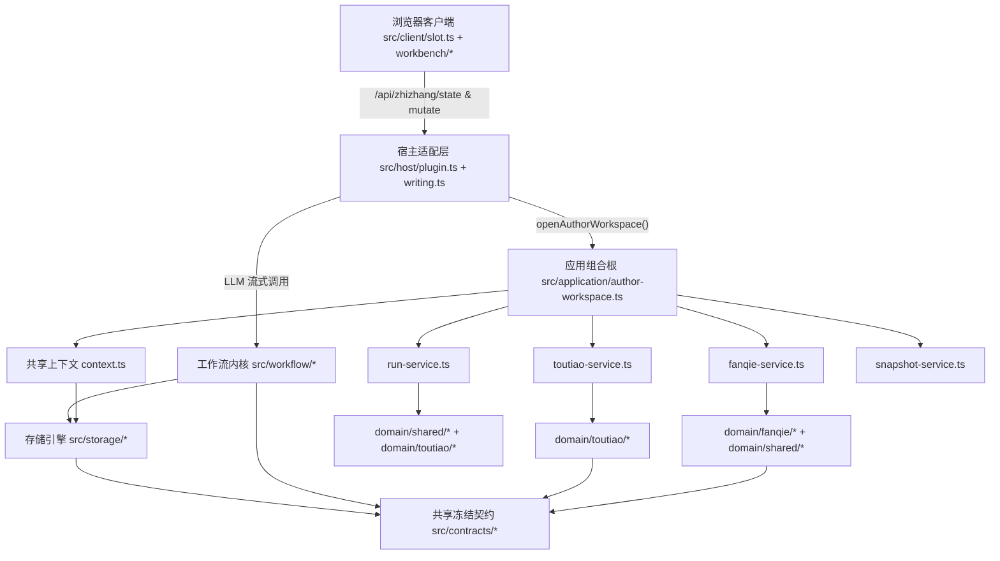

# 03 · 系统架构与接口手册

本文档深入源码剖析织章 V2 的**分层边界、垂直应用服务、DsH 宿主适配、模块化浏览器端实现与完整 HTTP/Action 接口**，并如实记录当前代码库的已识别技术债。存储底层与工作流内核细节见 [数据存储与工作流内核](./04-data-and-workflow.md)。

---

## 一、分层架构与依赖边界

织章 V2 采用严格单向依赖的分层架构：

### 硬性架构边界（由测试自动守护）

| 层级 | 目录 | 职责边界与自动化约束 |
| --- | --- | --- |
| **共享契约层** | `src/contracts/` | 冻结共享原语（`errors.ts`、`approval.ts`、`commands.ts`）与浏览器安全单一 DTO 真源 [workspace-dto.ts](../src/contracts/workspace-dto.ts) |
| **产品领域层** | `src/domain/` | `domain/shared/`、`domain/fanqie/`、`domain/toutiao/` 纯规则实现；**两条产品线严禁互相引用**，且不依赖 Host/Client/SQLite |
| **存储引擎层** | `src/storage/` | 唯一允许引入 `node:sqlite` 的地方是 [driver.ts](../src/storage/driver.ts)；`test/smoke.test.mjs` 断言 `storage` 对外只暴露 `openDatabase` 这一驱动入口 |
| **工作流内核层** | `src/workflow/` | 状态机、阶段注册表、预算守卫与通用只读投影底座；**严禁出现 Host/Adapter/具体产品线领域导入** |
| **应用服务层** | `src/application/` | 基于 [product-line.ts](../src/application/product-line.ts) 的底座服务 + 隔离产品线模块；`test/refactor-v2.test.mjs` 静态断言底座零产品耦合、双线零交叉 |
| **宿主适配层** | `src/host/` | 唯一感知 DsH Cordis 生命周期、Connection HTTP 路由、纯单次 LLM 传输与本机文件系统的层（严禁导入 `domain/`） |
| **客户端与打包** | `src/client/` / `src/bundle/` | 严禁直接访问存储；严禁调用原生 `window.confirm` / `prompt` / `alert`；`shell.ts` 与产品线 UI 插件零交叉导入（由 `test/refactor-v2.test.mjs` 静态断言） |

---

## 二、应用层与一体化产品线模块（`src/application/`）

- **[author-workspace.ts](../src/application/author-workspace.ts)**：应用组合根 `openAuthorWorkspace(db, writeDelivery)`。静态注册 `fanqieModule` 与 `toutiaoModule`，统一路由通用底座动作与产品线专属动作，暴露 `snapshot`、`readState`、`projectSeq`、`mutation`、`generationRunner`、`recoverStartup` 与运行账本方法。
- **[product-line.ts](../src/application/product-line.ts)**：定义 `ProductLineModule` 7 大扩展点与 `ProductLineRegistry`（建表、创建/保存钩子、冻结上下文、生成管线、专属 `actions`、快照贡献、只读模型与启动恢复）。
- **[context.ts](../src/application/context.ts)**：
  - **统一初始化**：调用 `createCommandSchema`、`createEventLogSchema`、`createDeliverySchema`、`createAuthorSchema`、各产品线 `initSchema`、`createGenerationLedger` 与 `createAuthorModelReader`；
  - **事务与事件**：提供 `atomic`（`BEGIN IMMEDIATE` 写事务，带 `ROLLBACK` 异常保护）、`read`（`BEGIN` 读事务）、`event()` 与动态 `isLockedDocument()` 门禁；
  - **运行守卫**：`stage()` 校验 `isLegalTransition` 并发送状态事件；`assertRunAvailable()` 跨连接防抢占。
- **[products/fanqie.ts](../src/application/products/fanqie.ts)**：番茄产品线模块。封装 3 张番茄扩展表、11 个专属动作（章纲/审稿/定稿/多人物设定/重排两步提交/证据锚点）、知情上下文冻结与 `settings-view`/`evidence` 只读归约器。
- **[products/toutiao.ts](../src/application/products/toutiao.ts)**：头条产品线模块。封装 5 张头条扩展表、7 个专属动作（场景规划/改题/QA/回改/验收/批准/交付）、`autoQa` 双轮自动回改管线（`createToutiaoGenerationRunner`）、`approval-history` 归约器与启动导出恢复 `resumeExports`。
- **[run-service.ts](../src/application/run-service.ts)**：纯底座写作任务服务，通过 `ProductLineRegistry` 委派上下文冻结、候选后处理与生成管线，不直接依赖任何产品线规则。
- **[snapshot-service.ts](../src/application/snapshot-service.ts)**：拼装通用工作区快照与瘦身任务窗口（`~75 KiB` 稳定响应）并合并产品线 `contributeSnapshot` 输出。

---

## 三、宿主适配层与打包元数据（`src/host/` & `src/bundle/`）

### 1. DsH Cordis 宿主插件（[src/host/plugin.ts](../src/host/plugin.ts)）

- **依赖注入**：声明 `export const inject = ["connection", "llm"] as const;`。
- **启动与恢复序列**：
  1. 校验 `config.dataDirectory`，以 `0o700` 权限创建数据根目录及 `deliveries/` 子目录；
  2. 打开或新建 `workspace.sqlite`，设置 `PRAGMA busy_timeout = 5000;`；
  3. 初始化 `openAuthorWorkspace` 并立即执行 **`workspace.recoverGenerations()`**（清理崩溃前残留的未完成生成尝试）和 **`workspace.resumeExports()`**（重试挂起的交付文件导出）；
  4. 通过 `ctx.connection.fetch.register` 注册 `/api/zhizhang/*` 下全部路由（依赖 DsH Web 0.2.2-rc.4 的 owner-only 鉴权边界）。
- **HTTP 安全加固**：
  - 静态资源响应头强制携带 `Content-Security-Policy: default-src 'self'; frame-ancestors 'self'; base-uri 'none'; object-src 'none'`、`X-Content-Type-Options: nosniff` 与 `Cache-Control: no-store`；
  - `/mutate` 仅接受 `Content-Type: application/json`，流式读取请求体并硬性限制上限 **2 MiB**（`MAX_REQUEST_BYTES`）；
  - `ContractError` 映射为结构化 `{ ok: false, code, details, diagnosticId }`，未预期异常记录 `ctx.logger.error` 后对外仅返回 `{ ok: false, code: "internal.error", diagnosticId }`，不泄露堆栈或正文内容。
- **原子交稿导出 `writeDelivery`**：
  - 若目标 `<documentId>.md` 已存在且内容与获批稿完全一致，直接幂等返回；
  - 否则先写入同目录隐藏临时文件 `.${id}.${uuid}.tmp`（权限 `0o600`、`flag: "wx"`、`flush: true`），再使用硬链接 `linkSync(pending, path)` 原子发布并清理临时文件；
  - 若目标文件已存在且内容不同，拒绝静默覆盖，抛出 `{ code: "export.conflict", retryable: false }` 留待作者手动处理冲突。
- **卸载清理**：置 `closing = true`、abort 所有内存中的 `generations` 控制器、并行注销全部 HTTP 路由、再次回收未完成生成并关闭数据库连接。

### 2. 一次性 LLM 生成传输（[src/host/writing.ts](../src/host/writing.ts)）

`writing.ts` 完全不导入任何产品领域模块，通过 `createSingleShotCaller` 与 `executeGenerationWithRunner` 提供严格**无工具、单轮、可审计**的底层传输能力：
- **单次调用保护 `complete()`**：
  1. 通过 `estimateWritingInput(system, prompt)` 计算保守预留（UTF-8 字节数 + 128）；
  2. 计算可用输出上限 `Math.min(run.reserved - usedTokens - inputReserve, maxOutputTokens)`，小于 1 直接抛 `budget.exhausted`；
  3. 从 `BudgetGuard` 预留额度，组合外部取消信号与 **180 秒单次超时** `AbortSignal.timeout(180_000)`；
  4. 调用 `llm.prepareCall(...)` 后通过 `receipts.begin` 在数据库落盘 `author_generation_calls` 记录，流式聚合文本块（硬上限 `MAX_CANDIDATE_LENGTH = 1_000_000` 字符，且不向 `call.stream` 传递 `tools`）；
  5. `finally` 块核验 4 元组用量（`inputTokens`/`outputTokens`/`cacheReadTokens`/`cacheWriteTokens`）：合法则 `receipts.receive` 并结算实际用量，缺失则释放预留并抛 `usage.uncertain`；
  6. 校验流结束原因为 `"stop"` 且输出通过 `StageRegistry` 对应阶段校验器（`write`/`qa`/`refine`）。
- **产品线管线委派**：宿主通过 `workspace.generationRunner(run.product)` 获取对应产品线管线（如头条在 [products/toutiao.ts](../src/application/products/toutiao.ts) 中编排的 `autoQa`：执行 `qa` 合并 `structuralGates` 后最多自动回改 2 轮），传输层自身保持领域无关。

### 3. 打包与 DsH 插件声明（`src/bundle/` & `package.json`）

- [package.json](../package.json) 暴露入口 `"." -> "./dist/host/plugin.js"` 与 `"./client" -> "./dist/client/slot.js"`，并声明 `dsh.client.inject` 注入 `@deepseek-ai/dsh-client-ui-conversation` 与 `@deepseek-ai/dsh-client-ui-sidebar`。
- [src/bundle/cordis.patch.yml](../src/bundle/cordis.patch.yml) 注册插件 ID `zhizhang-workbench`，默认配置 `dataDirectory: !!js dshHomePath('zhizhang-v2')`。

---

## 四、浏览器客户端实现（`src/client/`）

### 1. DsH UI Slot 入口（[src/client/slot.ts](../src/client/slot.ts)）

通过 `window.__ModuleLoader__.load` 注入 DsH 三个 UI 扩展点：`main`（主工作区）、`sidebar.panellist`（左侧「织」图标入口）、`conversation.view`（会话内「织章」视图），均通过独立 `<iframe>` 加载 `api/zhizhang/workbench`，与宿主 React 运行时完全隔离。

### 2. 模块化工作台（`src/client/workbench/*` & [manifest.ts](../src/client/manifest.ts)）

[src/client/workbench.html](../src/client/workbench.html) 加载 [src/client/workbench.css](../src/client/workbench.css) 与经 `tsconfig.client.json` 编译的 `workbench/main.js`（所有静态路由由 [src/client/manifest.ts](../src/client/manifest.ts) 单一清单统一输出）：

| 模块 | 职责与核心机制 |
| --- | --- |
| [main.ts](../src/client/workbench/main.ts) | 极薄启动入口，静态注册 `fanqieUiModule` 与 `toutiaoUiModule` 并启动 `bootWorkbench` |
| [shell.ts](../src/client/workbench/shell.ts) | **工作台通用底座壳**：左右侧栏折叠（保持滚动比例）、浅色纸面/深色墨石主题切换、通用目录/编辑器/冲突横幅/`Ctrl/Cmd+S` 保存、`DiffView`、`RunInspector`、通用任务生命线与 2 秒条件轮询，按 4 大标准槽位委派产品线插件 |
| [plugins/fanqie.ts](../src/client/workbench/plugins/fanqie.ts) | 番茄连载前端 UI 插件：审稿/定稿操作、四段式章纲、多人物设定提案/确认/分页/知情查询、正文证据锚点、上下移章与重排影响确认、生成段号控件 |
| [plugins/toutiao.ts](../src/client/workbench/plugins/toutiao.ts) | 头条创作前端 UI 插件：体裁/内容线创建、34 Unicode 码点计数、原地改题与候选套用、场景规划与标题矩阵、QA/回改/验收/版本批准/交稿导出与 Blob 下载、`autoQa` 复选框 |
| [draft-vault.ts](../src/client/workbench/draft-vault.ts) | **防丢字草稿保险箱**：双写 `sessionStorage` 与带标签页随机 `owner` 标记的 `localStorage`；配合 `editSequence` 实现「慢保存返回确认已发版本，期间继续键入的新文字保留在编辑器与新基准本地草稿中」；检测到跨标签页新版本时展示冲突横幅 |
| [diff.ts](../src/client/workbench/diff.ts) & [views/diff-view.ts](../src/client/workbench/views/diff-view.ts) | **纯段落级 LCS 差异对照**：将相邻删增段配对为 `changed` 行；当两侧段落数乘积超过 `250,000` 时自动降级为线性逐行对比以防主线程卡顿；提供「并排对照 / 行内高亮 / 候选原文」三种展示模式 |
| [modal.ts](../src/client/workbench/modal.ts) | **无障碍自定义 `<dialog>` 弹窗控制器**：替换所有浏览器原生 `confirm`/`prompt`（解决 iframe 沙箱禁用原生弹窗问题） |
| [views/run-inspector.ts](../src/client/workbench/views/run-inspector.ts) | **结构化任务审计器**：将冻结输入、生成尝试状态与每次模型调用的 4 类令牌明细表渲染为可读界面 |
| [api.ts](../src/client/workbench/api.ts) | 封装 `fetch` 调用、非 JSON 登录过期提示、常见错误 `reason` 中文转译与诊断号拼接 |

---

## 五、HTTP 与 Action 接口手册

所有请求均挂载在 `/api/zhizhang`（本地开发预览服务器 [scripts/dev-server.mjs](../scripts/dev-server.mjs) 挂载在根路径 `/`）。

### 1. 读取工作区状态：`GET /api/zhizhang/state`

- **查询参数**：`projectId`（可选）、`documentId`（可选）、`ifSequence`（可选，上一次收到的 `asOfSeq`）。
- **返回**：
  - 若 `ifSequence` 等于项目当前最新事件序号，返回 `{ ok: true, result: { unchanged: true } }`；
  - 否则返回 `WorkspaceSnapshot`，包含 `projects`、`documents`、`active`（含正文与计数）、`runs`（最多近期 2 条 + 活跃/`uncertain` 任务）、`approved`、`delivery`、`exportStatus`、`settings`（前 50 条）与 `settingsCursor`、`report`、`planning`、`scenario`、`asOfSeq`。

### 2. 执行业务动作：`POST /api/zhizhang/mutate`

请求体为 `{ "action": "<动作名>", ...input }`，共支持 **32 个动作**（其中 31 个由 `author-workspace.ts` 同步执行，1 个由宿主插件异步托管）：

| 分类 | `action` | 关键入参 | 执行特征与说明 |
| --- | --- | --- | --- |
| **通用 / 读模型** | `read.model` | `projectId`, `model`, 视模型附带 `documentId` / `asOfChapter` / `characterId` / `point` / `factId` / `runId` | 触发 6 大只读投影增量回放并返回 `{ key, asOfSeq, value, folded }` |
| | `project.create` | `name`, `product` (`"fanqie"` \| `"toutiao"`) | 创建项目并写 `project.created` 事件 |
| | `document.create` | `projectId`, `title`, 头条另传 `mode`, `line` | 头条校验 6 格矩阵与 34 字上限（微头条必须空标题） |
| | `draft.save` | `documentId`, `baseRevisionId`, `body` | 经 `command_journal` 校验基准修订；锁定态拒写；生成新 `revisionId` |
| **番茄连载 (11)** | `chapter.outline` | `documentId`, `viewpoint`, `target`, `lockedFacts`, `knowledge`, 4 块章纲正文 | 存入 `author_planning` 并返回超 1500–6000 字数提醒 `warnings` |
| | `chapter.review` | `documentId`, `baseRevisionId`, `accept` (boolean) | 校验当前正文修订；`accept=false` 计入打回（上限 2 次） |
| | `draft.finalize` | `documentId`, `baseRevisionId` | 经 `command_journal`；要求 `reviewed` 且打回 ≤2，锁定为 `final` |
| | `setting.propose` | `projectId`, `documentId`, `factId`, `note`, `source`, `from`, `to?`, `people?`/`character?`, `locked?` | 提交待确认提案；校验 `[from, to)` 非空与人物不重名 |
| | `setting.decide` | `projectId`, `documentId`, `proposalId`, `accept` (boolean) | 经 `command_journal`；写 `setting.decided` 事件并用序号更新 `decided_seq` |
| | `settings.read` | `projectId`, `character`, `at: { chapterId, point }` | 按批准序号裁决并过滤该人物在该章段已知的有效事实 |
| | `settings.history` | `projectId`, `before` | 降序分页查询 `author_settings`（每页 50 条，返回 `cursor`） |
| | `reorder.impact` | `projectId`, `chapterIds` | 只读计算章序变动翻转的设定时序关系与当前 `asOfSeq` |
| | `reorder.commit` | `projectId`, `chapterIds`, `asOfSeq`, `confirmed: true` | 校验水位一致与作者确认后写入 `author_chapter_order` |
| | `evidence.record` | `documentId`, `baseRevisionId`, `factId`, `quote` | 校验摘句在已保存正文中恰好匹配 1 次，记录锚点与字符区间 |
| | `evidence.detail` | `documentId`, `factId` | 读取 `evidence` 只读模型返回最近记录 |
| **头条创作 (7)** | `article.plan` | `documentId`, `driver`, `opening`, `ending`, `titles?` | 校验内容线可用项及标题矩阵（≥5 题且 ≥3 母题） |
| | `article.rename` | `documentId`, `baseRevisionId`, `title` | 校验 34 码点且非微头条；改题生成新修订并退回 `初稿待改` |
| | `article.qa` | `documentId`, `baseRevisionId`, `score`, `passed`, `fails`, `hardGates?` | 合并结构门禁；达标（≥84 且零失败/硬门）转 `待验收` |
| | `article.refine` | `documentId`, `baseRevisionId`, `body` | 仅 `初稿待改` 且 `qa_rounds < 2` 可保存手动回改新修订 |
| | `article.accept` | `documentId`, `baseRevisionId`, `accept`, `reason?` | 经 `command_journal`；仅 `待验收` 可验收通过（锁定）或记录退回原因 |
| | `approval.decide` | `documentId`, `baseRevisionId`, `confirmed: true` | 仅 `已验收` 可批准当前修订并记录 `delivery.approved` 事件 |
| | `article.deliver` | `documentId`, `baseRevisionId`, `key`（幂等键） | 经 `commitApprovedDelivery` 校验批准门与幂等，落库后执行原子文件导出 |
| **任务与候选 (10)** | `run.preview` | `documentId`, `baseRevisionId`, `instruction`, `point?` | 按冻结输入核算保守输入预留 `inputReserve` 与建议总额 `recommended` |
| | `run.start` | `documentId`, `baseRevisionId`, `instruction`, `tokenLimit`, `point?` | 经 `command_journal`；防同文档并发/未对账拦截；冻结写作上下文并创设 `running` 任务 |
| | `run.generate` | `runId`, `provider`, `model`, `autoQa?` | **宿主插件拦截处理**：原子领取 `attemptId` 后异步流式调用 LLM，**返回 HTTP `202`**（预览服务拒止） |
| | `run.complete` | `runId`, `tokens`, `body?`, `qa?`, `rounds?` | 手动导入候选或处理取消后迟到用量结算（通过 `late_usage_settled` 防重） |
| | `run.cancel` | `runId` | 将运行迁至终态 `cancelled`；若正在生成则触发 `AbortController.abort()` |
| | `run.discard` | `runId` | 将 `awaiting-author` 迁至终态 `discarded` 并关闭对应候选视图 |
| | `run.reconcile` | `documentId`, `runId`, `attemptId`, `tokens` | 对中断于 `inflight` 的 `uncertain` 尝试补录真实用量并解除文档生成阻塞 |
| | `run.detail` | `documentId`, `runId` | 按需获取 `frozenInput`、候选正文全文、`attempts` 与 `calls` 明细 |
| | `run.history` | `documentId`, `before?` | 基于 `rowid` 游标分页拉取历史任务摘要（每页 25 条） |
| | `candidate.adopt` | `documentId`, `baseRevisionId`, `runId`, `key` | 经 `command_journal`；校验候选基准修订一致后写入新工作修订并将任务迁至 `applied` |

---

## 六、一体化收口状态说明

前述架构审计中识别的三项技术债已按 [分阶段落地路线图](./framework/03-migration-roadmap.md) 全部完成收口：

1. **客户端与契约分叉已清零（M0–M1）**：已移除孤立残留的 `src/client/workbench.ts`、`src/client/app/*` 与分裂类型文件；所有前后端 DTO 统一收口于纯类型 [src/contracts/workspace-dto.ts](../src/contracts/workspace-dto.ts)，所有静态资产路径统一收口于 [src/client/manifest.ts](../src/client/manifest.ts)。
2. **旧版 `2.0.0` 数据库实现平滑升级（M2）**：[src/storage/author-schema.ts](../src/storage/author-schema.ts) 已支持幂等检测并清理旧版同名 `author_article_reports` 索引，补齐缺失列并从 `event_log` 回填批准顺序与历史报告，并由 `test/workspace-v2.test.mjs` 回归锁定。
3. **高并发锁升级与前后端解耦已收口（M2–M4）**：文件数据库统一启用 WAL 模式与 `busy_timeout = 5000`；`author-reads.ts` 已将只读快照查询与检查点写落盘分离；前后端双线分别通过 `ProductLineModule` 与 `ProductLineUiModule` 完全隔离。
