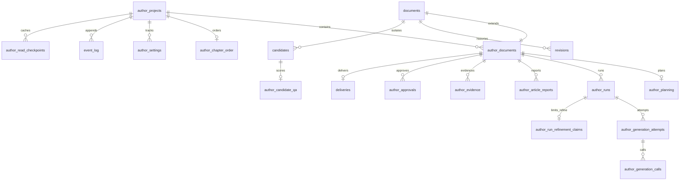
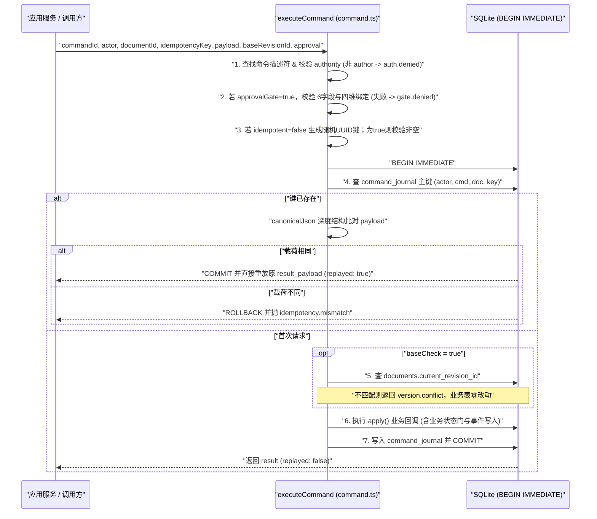
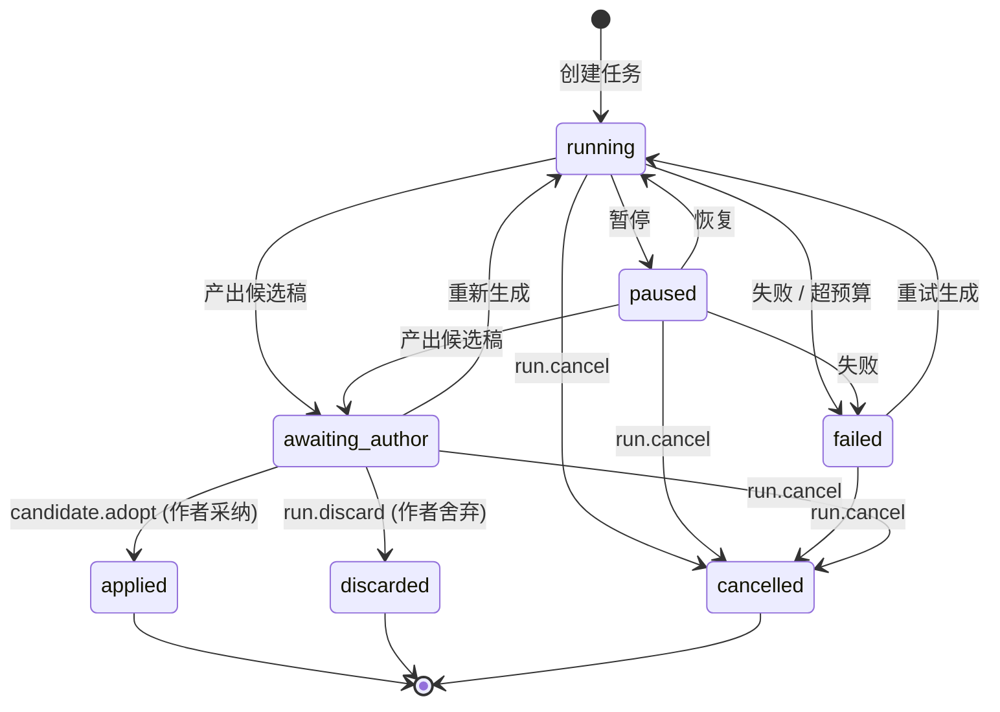

# 04 · 数据存储与工作流内核

本文档详述织章 V2 底层最核心的工程机制：**SQLite 存储引擎与 40 张表全景（以自动生成的 schema.md 为准）、单事务幂等命令账本、单项目事件日志与持久化只读投影冷恢复、工作流状态机与预算守卫、以及生成调用断电恢复与交稿导出状态机**。

---

## 一、SQLite 存储引擎与 Schema 全景

### 1. 驱动隔离与 Schema 窗口机制
- **单点驱动隔离**：[src/storage/driver.ts](../src/storage/driver.ts) 是全仓库唯一导入 `node:sqlite`（`DatabaseSync`）的文件，向上暴露极简抽象接口 `SqliteDatabase` / `SqliteStatement`。
- **Schema 窗口门禁（[schema.ts](../src/storage/schema.ts) / [store.ts](../src/storage/store.ts)）**：
  - 当前新建库写入 `meta('schema') = 'zhizhang/2.0'`；
  - `openStore(path)` 严格校验正则 `/^zhizhang\/2\.\d+$/`（仅接受 `zhizhang/2.x` 主版本窗口）；
  - 缺少 `meta` 行、字节损坏、或属于 v1.x / 3.x 的库**绝不尝试迁移或半吊子提供服务**，立即关闭已打开句柄并抛出 `StorageError("storage.format_unsupported")`。

### 2. 全量 40 张表分组清查

> 列、索引、触发器的逐项权威清单由 `npm run docs:schema` 从 `sqlite_master` 生成到 [schema.md](schema.md)，本节只维护分组与职责。FTS5 自动创建的 `fts_*_data/_idx/_content/_docsize/_config` 影子表不计入。

| 分组 | 源码文件 | 张数 | 表名 |
| --- | --- | :---: | --- |
| **元数据** | [store.ts](../src/storage/store.ts) | 1 | `meta`（`schema` 版本键、`db_uuid` 实例标识） |
| **命令与修订** | [command.ts](../src/storage/command.ts) | 5 | `documents`, `revisions`, `candidates`, `author_decisions`, `command_journal`（`PRIMARY KEY(actor_id, command_id, document_id, request_key)` 幂等账本 + `request_hash` 轻量审计） |
| **事件日志** | [eventlog.ts](../src/storage/eventlog.ts) | 2 | `event_log`（`PRIMARY KEY(project_id, seq)` + `UNIQUE(project_id, event_id)`）、`event_log_quarantine`（无法推断 concern 的隔离事件） |
| **通用投影** | [projection.ts](../src/storage/projection.ts) | 1 | `projection_rows`（按 `project_id, key` 存检查点，V2.3 起由每项目 `ProjectionStore` 共享折叠） |
| **交稿导出** | [export.ts](../src/storage/export.ts) | 1 | `deliveries`（`article_id PRIMARY KEY`、`export_state`、SHA-256 `export_hash`、错误对象与重试次数） |
| **作者工作台主体** | [author-schema.ts](../src/storage/author-schema.ts) | 24 | `author_projects`, `author_documents`, `author_volumes`, `author_acts`, `author_chapter_order`, `author_planning`, `author_runs`, `author_run_refinement_claims`, `author_candidate_qa`, `author_article_reports`, `author_evidence`, `author_approvals`, `author_settings`, `author_ai_proposals`, `author_foreshadows`, `author_lore_current`, `author_chapter_memory_sync`, `author_chapter_entities`, `author_chapter_observations`, `author_library_mounts`, `author_micro_calls`, `author_project_controls`, `author_project_slop_config`, `author_read_checkpoints` |
| **共享库** | [author-schema.ts](../src/storage/author-schema.ts) | 2 | `library_deconstructions`, `library_technique_cards` |
| **生成调用账本** | [author-generation.ts](../src/storage/author-generation.ts) | 2 | `author_generation_attempts`（`prepared`/`inflight`/`received`/`completed`/`failed`/`uncertain`/`reconciled`）、`author_generation_calls`（预留与四元组回执） |
| **FTS 行号映射** | [fts.ts](../src/storage/fts.ts) | 1 | `fts_rowid_map`（外部内容表 rowid ↔ 业务 id） |
| **迁移记录** | [migrations.ts](../src/storage/migrations.ts) | 1 | `schema_migrations`（原子版本迁移台账） |

关键查询索引（`author-schema.ts`）：
- `author_settings_approved_order`：局部索引 `(project_id, decided_seq) WHERE decision = 'approved'`，加速人物知情视图查询与逆序批准裁决；
- `author_reports_by_revision`：`(project_id, revision_id, id DESC)`，快速获取当前修订最新质检/退回报告；
- `author_evidence_by_fact`：`(project_id, fact_id)`，支撑按设定编号检索正文证据；
- `ux_proposal_inflight`：`(kind, COALESCE(document_id, project_id, 'global')) WHERE status='inflight'`，AI 提案的数据库级互斥；
- `author_documents_by_project`、`author_runs_by_document`、`author_generation_by_run`、`author_calls_by_attempt`；
- V2.3 热点：`revisions_by_document_created`、`candidates_by_document`、`author_generation_attempts_open`、`author_ai_proposals_by_doc`、`author_runs_by_doc_state`、`author_settings_by_project_fact`、`author_foreshadows_by_target`、`author_chapter_entities_by_name`、`author_read_checkpoints_lru`。

### 3. 核心实体关系图（ER）

### 4. V2.2 新增 Schema 演进表（`schema_migrations` 原子版本迁移）

除基线表外，[author-schema.ts](../src/storage/author-schema.ts) 与 [fts.ts](../src/storage/fts.ts) 在 V2.2 原子追加：
- **FTS5 External Content 与行号映射**：`fts_rowid_map` + `v_fts_chapters` / `v_fts_lore` / `v_fts_library` + `fts_chapters` / `fts_lore` / `fts_library`（支持 BM25 + RRF 多 Scope 防饿死排序）；
- **连贯性记忆闭环**：`author_chapter_memory_sync`（SHA-256 变更感知）与 `author_chapter_entities`（零 Token 实体出现倒排）；
- **技能、诊断与观察审稿**：`library_technique_cards` 扩展 `asset_kind`/`stage_bindings_json`/`references_json`、`author_project_slop_config` 与 `author_chapter_observations`；
- **控制面与滚动规划**：`author_project_controls`（`author_intent` / `current_focus`）及 `author_acts` 扩展 `arc_goal`/`arc_summary`/`pacing_template`、`author_runs` 扩展 `context_trace`/`recovery_hints`。

### 5. V2.3 新增 Schema 演进（6 个原子迁移）

| 迁移 ID | 变更 |
| --- | --- |
| `2.3.0-proposals-micro-generation-origin` | `author_ai_proposals` 增 `base_revision_id`、`source_sha256`、`origin`、`origin_ref`、`error_detail`；`author_settings` 增 `origin`；`author_read_checkpoints` 增 `last_used_at`；新建 `author_micro_calls`（微改写独立账本）与 `ux_proposal_inflight` 部分唯一索引 |
| `2.3.0-document-sort-key-and-backfill` | `author_documents` 增 `sort_key REAL`（同级分数索引），并按既有章序回填 |
| `2.3.0-controls-foreshadows-observations-memory` | `author_project_controls` 增 `pacing_tier`、`genre_tags_json`、`agent_tools_enabled`、`daily_target`、`stale_foreshadow_gap`、`token_calibration_json`；`author_foreshadows` 增 `hinted_chapter_ids_json`；`author_chapter_observations` 增 `verified`；`author_chapter_memory_sync` 增 `synced_revision_id` |
| `2.3.0-event-log-timestamps-and-quarantine` | `event_log` 补时间戳列；新建 `event_log_quarantine` |
| `2.3.0-hot-indexes` | 9 个热点索引（修订按文档+时间、候选按文档、未结生成尝试、提案按文档、运行按文档+状态、设定按项目+事实、伏笔按回收章、实体按名称、检查点 LRU） |
| `2.3.0-meta-version-and-uuid` | `meta` 增 `db_uuid`（连接级缓存键），`schema` 版本与 `PRAGMA user_version` 对齐 |

> 迁移仍按版本号命名（DB-09 的命名空间拆分尚未实施）；新表尚未统一使用 `STRICT` 与完整 `CHECK`（DB-10 待办）。

---

## 二、权威写事务与幂等命令账本

对应源码：[src/storage/command.ts](../src/storage/command.ts)。

对于 §2 注册的权威命令，`executeCommand` 与 `runAuthorWrite` 强制在**单个 `BEGIN IMMEDIATE` 排他写事务**内按不可颠倒的顺序执行校验与落库：

**核心保障**：
- **键序无关的结构化幂等**：`canonicalJson` 在每一层对象键上按字典序递归排序并忽略 `undefined`，避免字段序列化顺序差异误触发 `idempotency.mismatch`。
- **原子回滚**：第 6 步或之前任何环节抛出 `ContractError` 或未知异常，`ROLLBACK` 保证既无局部业务状态提交，也不残留 `command_journal` 记录。

---

## 三、项目事件日志与 6 大持久化只读模型

对应源码：[src/storage/eventlog.ts](../src/storage/eventlog.ts)、[src/storage/projection.ts](../src/storage/projection.ts)、[src/workflow/readmodels.ts](../src/workflow/readmodels.ts)、[src/workflow/readserve.ts](../src/workflow/readserve.ts)、[src/workflow/author-reads.ts](../src/workflow/author-reads.ts)。

### 1. 单项目单事件日志与游标协议
- **单调无竞态水位分配**：`appendEvent` 使用单条 SQL 语句 `INSERT INTO event_log ... SELECT ?, COALESCE(MAX(seq), 0) + 1, ... ON CONFLICT (project_id, event_id) DO NOTHING RETURNING seq` 原子分配项目内递增序号 `seq`，杜绝多连接并发读取同一最大值后的竞争。
- **7 个封闭 Concern 词表（`CONCERNS`）**：`chapter`、`revision`、`candidate`、`setting`、`evidence`、`run`、`approval`。`serveReadFromLog` 会校验每条事件的 `concern`，未登记词一律作为契约违例拒止。
- **客户端消费游标 `createCursor()`**：只认完整快照切面（`acceptSnapshot` 设置基线）+ 连续顺序回填（`applyBackfill` 遇缺口或重复序号直接整批拒绝 `gap`，不保留半截状态）。

### 2. 六大只读模型清单（`READ_MODELS`）

| 只读模型 ID | 版本 | 唯一键 (`key`) | 订阅 Concerns | 视图内容 |
| --- | :---: | --- | --- | --- |
| `navigation` | `1` | `["projectId"]` | `chapter` | 卷章目录树（含 `order` 与实时 `businessState`） |
| `revision-candidate` | `1` | `["projectId", "documentId"]` | `revision`, `candidate` | 文档当前修订、未关闭候选引用与 diff 锚点 |
| `settings-view` | `1` | `["projectId", "asOfChapter", "characterId"]` | `setting`, `chapter` | 指定章段下某角色当前已生效且已知的设定条目（支持 `point` 参数） |
| `evidence` | `1` | `["projectId", "factId"]` | `evidence`, `setting` | 指定 `factId` 最近一次正文精确摘句锚点与校验记录 |
| `run` | `1` | `["projectId", "runId"]` | `run` | 任务当前状态、预算预留/结算（含迟到用量 `lateSettled`）、检查点与尝试列表 |
| `approval-history` | `1` | `["projectId"]` | `approval` | 项目维度交稿批准流水列表 |

### 3. 持久化检查点与冷重启恢复链路

`author-reads.ts` 将内存 32 槽 LRU 缓存与 SQLite `author_read_checkpoints` 表结合：
1. **缓存未命中（如进程冷重启）**：从 `author_read_checkpoints` 读取对应 `[projectId, model, ...identity, point]` 键的快照；
2. **水位锚点回放**：通过 `store.restoreFloor()` 取得安全基线 `floor = seq - 1`，调用 `readTail(db, projectId, floor)` 从检查点前一位开始拉取日志尾部——若日志意外缩水导致前一位为空，则 `ProjectionStore.restore()` 立即拒绝服务 stale 行（`stale-projection-row`），若版本升级不匹配则自动回退到从 `seq = 1` 全量重放；
3. **增量折叠与 Schema 校验**：`serveReadFromLog` 仅折叠 `seq > startSeq` 的增量事件，随后加盖项目统一水位 `asOfSeq` 并通过 `validateReadValue()` 对全量 Schema 进行递归检查（不合规则报 `stage.output_invalid` 并指出故障路径）；
4. **安全返还与落盘**：有新事件折叠或刚从检查点水合时，回写更新 `author_read_checkpoints`；返回前执行 `structuredClone`，防止调用方修改对象污染内存缓存。

---

## 四、工作流内核（`src/workflow/`）

### 1. 运行状态机（[runstate.ts](../src/workflow/runstate.ts)）

共 **7 个封闭状态、14 条合法迁移边**；1 个唯一初始态（`running`），3 个无出边终态（`cancelled`、`applied`、`discarded`）：

*(注：代码中状态值为连字符 `"awaiting-author"`，因 Mermaid 标识符限制此处写为 `awaiting_author`。)*

**取消后迟到用量原则**：任务一旦迁入 `cancelled`，任何迟到的模型完成回调不得再写入候选稿或修改任务状态，仅结算一次令牌用量（在业务表由 `author_runs.late_usage_settled` 标记控制，在读模型由 `run.usage.late` 事件的 `lateSettled` 标志控制，确保两本账严格一致）。

### 2. 阶段注册表（[stages.ts](../src/workflow/stages.ts) & [writing-stages.ts](../src/workflow/writing-stages.ts)）
- **命名与版本号契约**：阶段 ID 必须匹配三段小写点分格式 `domain.entity.action` + 正整数 `version`，且动作段**禁止出现 7 个作者主权词**：`adopt`、`finalize`、`decide`、`accept`、`deliver`、`approve`、`save`（出现则报 `gate.denied`）。
- **不可静默覆盖**：同一 `id@version` 重复注册报 `idempotency.mismatch`。
- **内置写作阶段（`WRITING_STAGES`）**：
  - `draft.write.candidate@1`（`model`）：校验输出为非空字符串且长度 `<= 1,000,000`；
  - `article.qa.review@1`（`model`）：校验 JSON 结构含整数 `overall ∈ [0, 100]`、布尔 `passed`、字符串数组 `fails` 与 `hardGates`；
  - `article.qa.refine@1`（`model`）：校验输出为非空合规文本。

### 3. 预算守卫与写作令牌估算（[budget.ts](../src/workflow/budget.ts) & [writing-budget.ts](../src/workflow/writing-budget.ts)）
- **四类冻结令牌词汇（`TOKEN_CATEGORIES`）**：`input`、`output`、`cache_read`、`cache_write`；`totalTokens()` 对四类求和。
- **双阶段保守估算**：
  - `estimateWritingInput(system, prompt)`：`UTF-8 字节数 + 128`（针对中文稿件在无厂商本地分词器时防止低估）；
  - `recommendedTokenBudget(inputReserve)`：`max(8000, ceil((inputReserve * 2 + 2400) / 1000) * 1000)`。
- **预算拦截顺序**：单次预留超 `inputBudget` 立即拒止（不残留 `inflight` 锁定）；`used + inflight + estimate > runBudget` 拒止；若配置了 `moneyCap` 且累计费用为 `null`（价格未知）则抛 `usage.uncertain`（绝不猜测余量或由后续已知价格回填覆盖未知）。`release()` 与 `settle()` 均具备幂等防重保护。

---

## 五、生成调用账本、恢复与交稿导出

### 1. 生成尝试账本与跨进程抢占防护（[author-generation.ts](../src/storage/author-generation.ts)）
- 一次 `run.generate` 创建一条 `author_generation_attempts` 记录（初始 `prepared`），随后每发起一次 LLM 调用插入一条 `author_generation_calls`（并把尝试切至 `inflight`）；收到流式用量后更新调用记录并追加 JSON 数组中（尝试切至 `received`），允许 `autoQa` 多阶段在同一尝试下顺次推进；最终收口为 `completed` / `failed`。
- **异常中断自愈 `recoverGenerations()`**：宿主启动或卸载时扫描所有处于开放态（`prepared`/`inflight`/`received`）的尝试。若中断时停留在 `inflight`（已发请求未收到用量回执），则将尝试标记为 **`uncertain`**，并只结算此前已收到回执的子调用令牌；文档级互斥锁 `unresolvedForDocument()` 会阻断后续生成，直至作者在 DsH 查账并通过 `run.reconcile` 补录缺失用量（置 `reconciled`）。

### 2. 交稿事务与可重试导出分离（[delivery.ts](../src/storage/delivery.ts) & [export.ts](../src/storage/export.ts)）
- `article.deliver` 通过 `commitApprovedDelivery` 在单事务内检验作者权限、版本绑定批准记录、幂等键、基准修订与 `已验收` 状态，同时向 `deliveries` 表写入唯一交付行（初始 `export_state = 'pending'`）并将文档流转至 `已交稿`。
- **事务外执行磁盘写出**：`attemptExport` 在事务提交后执行外部文件写入并计算内容 SHA-256 存入 `export_hash`；写入失败不回滚数据库交付记录，而是根据错误对象的 `retryable` 属性分流：
  - `retryable !== false`（如瞬时 IO 错误）：保留在 `pendingExports` 列表，插件重启调用 `resumeExports()` 时自动重放；
  - `retryable === false`（如目标同名文件已存在且内容冲突 `export.conflict`）：转入 `reconcileExports().needsAuthor`，退出自动重试队列并提示作者人工处理后再点重试。
