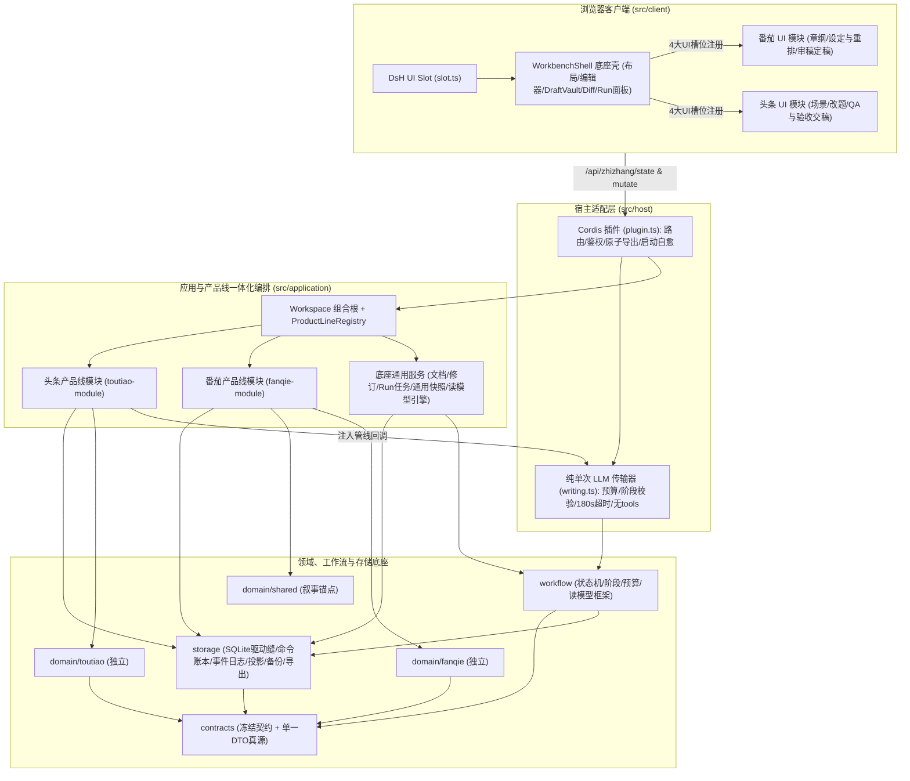

# 01 · 一体化框架总体蓝图

本文档回答 **「为什么要将织章 V2 收口为一体化框架、当前代码存在哪些割裂、目标架构形态是什么、以及坚决不做什么」**。具体接口契约与落地排期见 [核心接口与扩展点规范](./02-contracts-and-extensions.md) 与 [分阶段落地路线图](./03-migration-roadmap.md)。

---

## 一、现状耦合与割裂诊断

经过前两轮功能交付与初步拆分（提交 `bbf7def`），织章 V2 已经跑通番茄连载与头条创作双流程，但在工程结构上仍处于 **「物理拆出文件、逻辑仍硬编码交叉」** 的过渡态。对照当前源码，共存在五类割裂与越界问题：

| 诊断维度 | 当前源码精确位置 | 具体问题表现 |
| --- | --- | --- |
| **1. 应用层双线硬编码耦合** | [author-workspace.ts](../../src/application/author-workspace.ts) [run-service.ts](../../src/application/run-service.ts) [snapshot-service.ts](../../src/application/snapshot-service.ts) [context.ts](../../src/application/context.ts) | • `author-workspace.ts` 在 `document.create` 中让番茄章节借用 `toutiao.validateArticleTitle(null, title)`，并用 31 分支 `switch` 硬编码路由； • `run-service.ts` 直接导入 `domain/toutiao` 的 `QA_REFINEMENT_LIMIT` 并同时持有 `fanqie` 与 `toutiao` 两个服务引用，在 `freezeWriting` / `completeRun` / `generationInput` 中写死产品线分支； • `snapshot-service.ts` 在拼装快照时硬编码调用两条产品线的私有表与查询； • `context.ts` 硬编码锁定态数组 `["final", "已验收", "已交稿"]`。 |
| **2. 宿主层越界承载领域规则** | [writing.ts](../../src/host/writing.ts) | `src/host/writing.ts` 直接导入 `domain/toutiao` 的 `structuralGates` 与 `refineArticle`，并在 `generateCandidate()` 内部编排头条 `autoQa` 回改循环。这直接违背了 [AGENTS.md](../../AGENTS.md) 中 **「`host/` 不得拥有领域规则」** 的架构边界。 |
| **3. 工作流读模型引擎混入业务细节** | [author-reads.ts](../../src/workflow/author-reads.ts) | `src/workflow/author-reads.ts` 一方面承担通用持久化投影与 LRU 检查点机制，另一方面直接导入 `domain/fanqie` 的 `settingsAt` 并在 `navigation` / `approvals` 归约器中硬编码 `"初稿待改"`、`"planned"` 与 `"article.deliver"`。 |
| **4. 客户端与契约双套分叉** | [workbench/main.ts](../../src/client/workbench/main.ts) `src/client/workbench.ts` + `src/client/app/*` `src/contracts/workspace.ts` [plugin.ts](../../src/host/plugin.ts) / [dev-server.mjs](../../scripts/dev-server.mjs) / [browser-check.mjs](../../scripts/browser-check.mjs) | • 仓库并存两套前端实现：实际挂载的是 `src/client/workbench/*`（其中 `main.ts` 达 1,130 行且混写番茄/头条 DOM），而 `workbench.ts` + `src/client/app/*`（9 个文件）为未接线残留且未被 `tsconfig.json` 排除； • DTO 类型分别定义在 `contracts/workspace.ts` 与 `client/workbench/types.ts` 两处； • 8 个浏览器端静态 JS 模块路径清单在 `plugin.ts`、`dev-server.mjs`、`browser-check.mjs` 三处硬编码重复。 |
| **5. 存储并发与版本演进隐患** | [author-schema.ts](../../src/storage/author-schema.ts) [schema.ts](../../src/storage/schema.ts) [context.ts](../../src/application/context.ts) | • `author-schema.ts` 为洁净建表而 `SCHEMA_ID` 仍为 `"zhizhang/2.0"`，缺少针对前期 2.0.0 旧库的识别或列迁移防护； • `read.model` 与 `evidence.detail` 在 `BEGIN` 只读事务中执行时，若折叠新事件会升级写 `author_read_checkpoints`，在多连接并发且未开启 WAL 时存在 `SQLITE_BUSY` 风险。 |

---

## 二、目标架构：单底座 + 双隔离产品线模块

一体化框架的核心思想是：**下沉共性底座，收口差异产品线**。

- **横向共享底座（Core Platform）**：统一拥有错误信封与命令契约、SQLite 核心底座表与幂等命令账本、事件日志与通用投影引擎、工作流内核（运行状态机 / 阶段注册表 / 预算守卫 / 生成调用账本）、通用文档与任务服务、DsH Cordis 宿主与纯单次 LLM 传输器、以及浏览器端 Workbench Shell。
- **纵向隔离产品线（Product Line Modules）**：**番茄连载（`fanqie`）** 与 **头条创作（`toutiao`）** 分别收口为自包含的业务模块，前后端均通过清晰、有限的静态注册扩展点接入底座。**两条产品线之间零交叉引用，底座代码零硬编码产品分支。**

---

## 三、底座与产品线职责切分矩阵

| 关注点 | 共享底座（Core Platform）负责 | 产品线模块（`fanqie` / `toutiao`）负责 |
| --- | --- | --- |
| **1. 项目与文稿模型** | 维护 `author_projects`、`documents`、`revisions`、`author_documents` 公共列与线性修订链 | 声明自身 `initialState`、`lockedStates`、扩展字段校验（如 `mode` / `line` / 标题规则） |
| **2. 存稿与状态流转** | `draft.save` 事务、基准冲突检查、锁定态通用拦截、`revision.saved` 事件 | 通过 `onDraftSaved` 回调决定保存后的业务状态迁移与状态事件 |
| **3. 规划与元数据** | 提供通用 `author_planning` JSON 键值存储与读取 | 各自校验与渲染四段章纲（番茄）或场景驱动+标题矩阵（头条） |
| **4. 写作任务冻结输入** | 提取公共文档正文/标题/指令并执行 `BudgetGuard` 预算估算与 `author_runs` 落库 | 通过 `buildFrozenContext` 注入专属上下文（番茄：人物知情事实；头条：体裁场景规则） |
| **5. LLM 生成与自动回改** | `writing.ts` 纯单次 `complete()` 流式传输（180s 超时、无 `tools`、4 类令牌回执、`StageRegistry` 校验） | 头条通过自己的生成管线回调编排 `qa → refine × ≤2`；番茄直接执行单轮撰写 |
| **6. 候选对比与采纳** | `candidates` 表隔离存储、段落 LCS Diff 对比、基准一致校验、`candidate.adopt` 事务与 `author_decisions` | 渲染候选专属元信息（如头条候选 QA 评分与自动回改轮次），落库 `author_candidate_qa` |
| **7. 专属工作流命令** | 统一提供 `atomic` / `read` / `dispatch` 事务与幂等命令账本基础设施 | 声明式注册各自专属 `actions`（番茄 11 个，头条 7 个） |
| **8. 持久化只读模型** | 提供 `ProjectionStore`、`serveReadFromLog`、LRU 与 `author_read_checkpoints` 引擎，及通用 `navigation`/`revision-candidate`/`run` | 注册专属只读模型归约器（番茄：`settings-view`、`evidence`；头条：`approval-history`） |
| **9. 工作台快照装配** | 装配 `projects`、`documents`、`active`、`runs`（含长历史分页瘦身）与 `asOfSeq` | 通过 `contributeSnapshot` 附加各自专属片段（`settings` vs `approved`/`delivery`/`report`/`scenario`） |
| **10. 本地交付与启动自愈** | 宿主启动扫描恢复挂起的生成尝试，并依次触发各产品线的 `onStartupRecover` | 头条实现 `deliveries` 原子导出与 `resumeExports()` 自愈 |
| **11. 浏览器工作台 Shell** | 导航栏、左右折叠侧栏、主题切换、通知与诊断号、`ModalController`、编辑器与 `DraftVault`、Diff 与 Run 面板 | 通过 4 个声明式 UI 槽位注入创建附加项、标题条、流程页签与任务启动附加控件 |
| **12. 离线备份与恢复** | `workspace.sqlite` 与 `deliveries/*.md` SHA-256 清单备份、恢复校验与保留策略 | 无需各自重复实现 |

---

## 四、不可突破的不变式与反过度设计红线

### 1. 受保护业务语义不变式（来自 [AGENTS.md](../../AGENTS.md)）
任何重构阶段**严禁**变更以下受保护规则：
- **作者主权与三态分离**：所有 §2 权威写命令与批准决策仅限 `author`，工作稿、候选稿、定稿/已批准交稿三者永不混用；
- **头条受保护阈值**：标题上限 `34` Unicode 码点、QA 通过线 `84` 分（且 `passed === true && fails.length === 0 && hardGates.length === 0`）、自动/手动回改上限 `2` 轮、交稿固定尾句 `——AI 到此止步。是否采用、何时发布由你决定。`（仅输出一次）；
- **番茄受保护阈值**：审稿打回上限 `2` 次、定稿须经 `reviewed` 态、5 态词表与重排两步先审影响再提交约束；
- **安全与审计底线**：`host/writing.ts` 绝对不传 `tools` 或 Agent 会话上下文；所有令牌使用 4 类词表（`input`/`output`/`cache_read`/`cache_write`），断电 `inflight` 尝试标为 `uncertain` 并阻断生成直到作者核账。

### 2. 反过度设计红线（明确不做的事）
立足当前 **番茄 + 头条** 与 **DsH Web `0.2.2-rc.4`** 收口，本框架严格克制，**禁止以下过度设计**：
1. **不做运行时动态插件加载器**：产品线模块与 UI 插件一律在编译期静态数组注册，不引入动态插件发现、权限沙箱或远程插件市场。
2. **不引入第三方依赖或构建打包器**：继续保持 `dependencies` 为空（零运行时依赖），坚持纯 TypeScript 编译为原生浏览器/Node ESM，不引入 Webpack/Vite/React 状态管理库。
3. **不抽象通用多宿主平台层**：不设计脱离 DsH Web `0.2.2-rc.4` 的虚拟宿主适配器矩阵（Cordis `effect` / `connection.fetch` / `llm` 与 `window.__ModuleLoader__` 足够清晰直接）。
4. **不把 SQLite 关系表抽象成无模式 KV/EAV**：底座表与产品线扩展表继续使用强类型 SQL 表与精确索引，保留 `650 章 < 75 KiB / ~1ms` 的查询性能优势。
