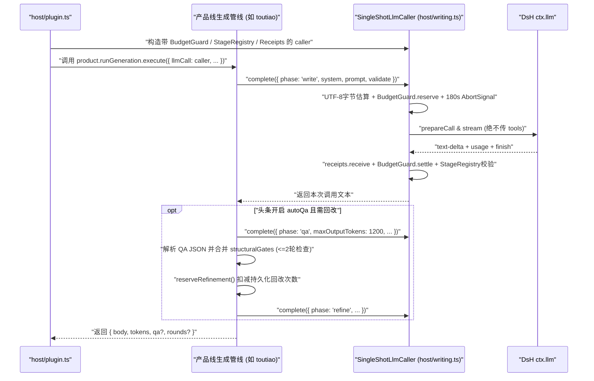

# 02 · 核心接口与扩展点规范

本文档定义一体化框架的具体接口签名、共享契约收口方案、前后端扩展点协议、存储表归属与自动化测试守卫规范，作为后续落地重构的直接设计准绳。

> **TypeScript 语法约束**：以下全部接口草案严格对齐 [tsconfig.json](../../tsconfig.json) 与 [tsconfig.client.json](../../tsconfig.client.json) 的 `strict: true`、`verbatimModuleSyntax: true` 与 `erasableSyntaxOnly: true`（禁用 `enum`、参数属性及非类型擦除语法）。

---

## 一、契约单一真源与静态清单收口

### 1. 消除共享契约分叉
- **冻结契约区（维持不变）**：`src/contracts/errors.ts`、`src/contracts/approval.ts`、`src/contracts/commands.ts`。
- **浏览器安全 DTO 单一真源（[src/contracts/workspace-dto.ts](../../src/contracts/workspace-dto.ts)）**：
  - 将原并存重复的 `src/contracts/workspace.ts` 与 `src/client/workbench/types.ts` 合并收口为 `src/contracts/workspace-dto.ts`（零 Node 内置依赖，前后端共同引用）。
  - 由同一份类型覆盖 `WorkspaceSnapshot`、`ActiveDocumentView`、`RunSummaryView`、`RunDetailView`、`SettingEntryDto`、`WorkspaceAction` 与 `ApiEnvelope<T>`，彻底消除前后端字段名或可选性漂移。

### 2. 消除静态资源清单三处重复
- 新增唯一清单文件 `src/client/manifest.ts`（零 DOM/Node 依赖，纯常量数组）：
  ```ts
  export const CLIENT_ENTRY_HTML = "workbench.html" as const;
  export const CLIENT_ENTRY_CSS = "workbench.css" as const;
  export const CLIENT_JS_MODULES = [
    "workbench/main.js",
    "workbench/types.js",
    "workbench/diff.js",
    "workbench/api.js",
    "workbench/draft-vault.js",
    "workbench/modal.js",
    "workbench/views/diff-view.js",
    "workbench/views/run-inspector.js",
    // M4 拆分后追加 shell 与双线 ui 模块路径，仅此处维护一份
  ] as const;
  ```
- [src/host/plugin.ts](../../src/host/plugin.ts)、[scripts/dev-server.mjs](../../scripts/dev-server.mjs) 与 [scripts/browser-check.mjs](../../scripts/browser-check.mjs) 全部从该清单导入，避免以后增删客户端模块时遗漏任何一处路由表。

---

## 二、后端一体化核心接口：`ProductLineModule`

产品线通过统一的后端模块契约静态注册到底座，取代散落在 `author-workspace.ts`、`run-service.ts`、`snapshot-service.ts` 与 `author-reads.ts` 中的产品分支判断。

### 1. 核心接口签名草案（面向 `src/application/product-line.ts`）

```ts
import type { ProjectionUnit, SqliteDatabase } from "../storage/index.ts";
import type { DocumentStatusWord, Product } from "../contracts/workspace-dto.ts";
import type { Concern, ReadDefinition } from "../workflow/index.ts";
import type { DocumentRow, Input, WorkspaceContext } from "./context.ts";

export interface ActionDefinition {
  readonly scope: "project" | "document" | "custom";
  readonly handler: (ctx: WorkspaceContext, input: Input, row?: DocumentRow) => unknown;
}

export interface ProductReadModelFactory {
  readonly definition: ReadDefinition;
  createUnit(projectId: string, identity: readonly string[], point: number): ProjectionUnit<unknown>;
}

export interface ProductGenerationRunner {
  execute(deps: {
    readonly llmCall: SingleShotLlmCaller;
    readonly frozenInput: string;
    readonly reserved: number;
    readonly autoQa: boolean;
    readonly signal: AbortSignal;
    readonly reserveRefinement: () => void;
  }): Promise<{
    readonly body: string;
    readonly tokens: number;
    readonly qa?: Readonly<Record<string, unknown>>;
    readonly rounds?: number;
  }>;
}

export interface ProductLineModule {
  /** 产品线唯一标识（"fanqie" | "toutiao"） */
  readonly id: Product;
  /** 新建文稿时的初始状态词 */
  readonly initialState: DocumentStatusWord;
  /** 锁定不可改的状态词集合（由底座统一据此判定只读门禁） */
  readonly lockedStates: readonly DocumentStatusWord[];

  /** 1. 建表钩子：由产品线自行创建专属扩展表与索引 */
  initSchema(db: SqliteDatabase): void;

  /** 2. 文稿创建与正文保存生命周期钩子 */
  validateCreate(input: Input, title: string): {
    readonly title: string;
    readonly mode: string | null;
    readonly line: string | null;
  };
  onDraftSaved(ctx: WorkspaceContext, row: DocumentRow): void;

  /** 3. 生成输入冻结与候选完成钩子 */
  buildFrozenContext(ctx: WorkspaceContext, row: DocumentRow, input: Input): Record<string, unknown>;
  onCandidateCreated?(
    ctx: WorkspaceContext,
    row: DocumentRow,
    candidateId: string,
    body: string,
    frozenInput: string,
    input: Input,
  ): void;

  /** 4. 产品线生成管线工厂（替代 host/writing.ts 中的领域分支） */
  runGeneration?: ProductGenerationRunner;

  /** 5. 专属动作处理器映射（如 chapter.outline / article.qa 等） */
  readonly actions: Readonly<Record<string, ActionDefinition>>;

  /** 6. 快照专属字段贡献者（替代 snapshot-service.ts 硬编码分支） */
  contributeSnapshot(
    ctx: WorkspaceContext,
    projectId: string,
    active: DocumentRow | undefined,
  ): Record<string, unknown>;

  /** 7. 持久化只读模型扩展与启动恢复钩子 */
  readonly readModels: Readonly<Record<string, ProductReadModelFactory>>;
  onStartupRecover?(ctx: WorkspaceContext): void;
}
```

### 2. 双产品线模块接入映射表

| 扩展点 | 番茄连载模块（`fanqie`） | 头条创作模块（`toutiao`） |
| --- | --- | --- |
| `initialState` / `lockedStates` | `"planned"` / `["final"]` | `"初稿待改"` / `["已验收", "已交稿"]` |
| `initSchema` | 创建 `author_settings`、`author_chapter_order`、`author_evidence` 及索引 | 创建 `author_article_reports`、`author_approvals`、`author_candidate_qa`、`author_run_refinement_claims`、`deliveries` 及索引 |
| `validateCreate` | 仅校验可选标题文本（不走头条 `validateArticleTitle`） | 校验 6 格 `mode`/`line` 与 `TITLE_MAX = 34`（微头条强制无标题） |
| `onDraftSaved` | `planned`/`drafting` → `drafting`，其余未锁定态 → `drafted` | 任意未锁定态 → `初稿待改` |
| `buildFrozenContext` | 注入 `knownAt` 锚点、当前视角人物 `knownFacts`（经 `settingsAt` 过滤） | 注入 `scenario`（体裁字数与内容线约束） |
| `runGeneration` | 默认单次 `write` 调用（无 `autoQa`） | 若 `autoQa=true`，编排 `write → qa → (refine → qa) × ≤2` 并合并 `structuralGates` |
| `onCandidateCreated` | 无 | 若含 `qa` 载荷，写入 `author_candidate_qa`（校验 `rounds <= 2`） |
| `actions` (共 18 个专属动作) | 11 个：`chapter.*`、`setting.*`、`settings.*`、`reorder.*`、`evidence.*`、`draft.finalize` | 7 个：`article.*`、`approval.decide` |
| `contributeSnapshot` | `{ settings, settingsCursor }` | `{ approved, delivery, exportStatus, report, scenario }` |
| `readModels` | `settings-view`、`evidence` | `approval-history` |
| `onStartupRecover` | 无 | `resumeExports()`（重试挂起但未达作者冲突的本地交付导出） |

> 底座自身保留通用只读模型 `navigation`（仅按 `document.state` 或默认初始态，不再硬编码双线中文词）、`revision-candidate` 与 `run`。

---

## 三、宿主 LLM 纯传输解耦协议（`src/host/writing.ts`）

一体化之后，`src/host/writing.ts` **不再导入任何 `domain/*` 模块**，回归为纯粹的「单次流式 LLM 调用传输器」`SingleShotLlmCaller`：



```ts
export interface SingleShotCallRequest {
  readonly phase: WritingPhase;
  readonly system: string;
  readonly prompt: string;
  readonly maxOutputTokens?: number;
}

export interface SingleShotLlmCaller {
  complete(request: SingleShotCallRequest): Promise<string>;
  usedTokens(): number;
}
```

这一收口同时满足了 `AGENTS.md`（`host/` 不得拥有业务规则）并完整保留 `scripts/model-check.mjs` 验证过的全部预算与阶段校验语义。

---

## 四、前端工作台一体化：`WorkbenchShell` + `ProductLineUiModule`

### 1. 客户端收口策略
- **清理孤立代码**：彻底删除未接线的 `src/client/workbench.ts` 与 `src/client/app/*`（共 9 个文件）。
- **拆分运行中代码**：将原 1,130 行的 [src/client/workbench/main.ts](../../src/client/workbench/main.ts) 演进拆分为：
  - `src/client/workbench/shell.ts`（工作台通用壳与事件总控）
  - `src/client/workbench/plugins/types.ts`（前端插件契约）
  - `src/client/workbench/plugins/fanqie.ts`（番茄专属 UI 插件）
  - `src/client/workbench/plugins/toutiao.ts`（头条专属 UI 插件）
  - 复用现有已经过浏览器测试的 `api.ts`、`draft-vault.ts`、`diff.ts`、`modal.ts`、`views/diff-view.ts`、`views/run-inspector.ts`。

### 2. 四大标准化 UI 槽位契约

```ts
export interface WorkbenchShellHost {
  getState(): {
    readonly projectId: string;
    readonly documentId: string;
    readonly snapshot: WorkspaceSnapshot;
    readonly composing: boolean;
  };
  readEditorValue(): string;
  isDirty(): boolean;
  stashEditor(): void;
  perform(work: () => Promise<unknown> | void): Promise<void>;
  change<T = Record<string, unknown>>(
    action: string,
    extra?: Record<string, unknown>,
    options?: { clearDraft?: boolean; savedVersion?: boolean; message?: string },
  ): Promise<T>;
  request<T>(action?: string, input?: Record<string, unknown>): Promise<T>;
  notice(message: string, isError?: boolean): void;
  readonly modal: ModalController;
}

export interface ProductLineUiModule {
  readonly id: Product;
  readonly displayName: string;
  readonly documentTypeLabel: (snapshot: WorkspaceSnapshot) => string;
  readonly stateLabels: Readonly<Record<string, string>>;
  readonly wordCountHint: (snapshot: WorkspaceSnapshot) => string;
  readonly visibleTabs: readonly ("workflow" | "planning" | "continuity" | "runs")[];

  /** 绑定 DOM 并接管各自专属区域的事件监听与渲染 */
  mount(host: WorkbenchShellHost): ProductLineUiSession;
}

export interface ProductLineUiSession {
  /** 槽位 1：新建稿件弹窗扩展（头条返回体裁/内容线/34字校验；番茄隐藏） */
  onCreateDocumentFormChanged?(): void;
  /** 槽位 2：正文上方标题条扩展（头条原地改题+套用矩阵；番茄隐藏） */
  renderHeaderSlot(snapshot: WorkspaceSnapshot): void;
  /** 槽位 3：右侧流程面板（流转操作、规划表单、连续性设定） */
  renderPipelineSlots(snapshot: WorkspaceSnapshot): void;
  /** 槽位 4：发起生成任务附加参数（番茄知情段落 point；头条 autoQa 开关） */
  renderRunStartExtras(snapshot: WorkspaceSnapshot): void;
}
```

---

## 五、存储表归属划分与事务加固规范

### 1. 底座公共表（15 张）vs 产品线扩展表（8 张）

| 归属 | 表清单 |
| --- | --- |
| **共享底座核心表 (15)** | `meta`、`documents`、`revisions`、`candidates`、`author_decisions`、`command_journal`、`event_log`、`projection_rows`、`author_projects`、`author_documents`、`author_runs`、`author_planning`、`author_read_checkpoints`、`author_generation_attempts`、`author_generation_calls` |
| **番茄连载扩展表 (3)** | `author_settings`、`author_chapter_order`、`author_evidence` |
| **头条创作扩展表 (5)** | `author_article_reports`、`author_approvals`、`author_candidate_qa`、`author_run_refinement_claims`、`deliveries` |

### 2. SQLite 并发与 Schema 演进规范
1. **统一开启 WAL 模式**：宿主与多连接场景打开持久化磁盘数据库文件时，在 `busy_timeout = 5000` 旁统一执行 `PRAGMA journal_mode = WAL;`（内存库 `:memory:` 自动忽略）。
2. **杜绝只读事务隐式升级写锁**：`read.model` 与 `evidence.detail` 若需将新折叠的 `author_read_checkpoints` 写入磁盘，应先在只读读取阶段计算新状态或使用独立 `BEGIN IMMEDIATE` 事务落盘检查点，禁止在 `BEGIN` 读事务内直接执行 `INSERT/UPDATE`。
3. **异常 `ROLLBACK` 保护**：[src/application/context.ts](../../src/application/context.ts) 的事务回滚块须与 [src/storage/command.ts](../../src/storage/command.ts) 对齐，使用内部 `try { db.exec("ROLLBACK"); } catch {}` 防止覆盖原始业务错误。
4. **Schema 窗口策略**：若确认要接纳重构前 `2.0.0` 旧库，应由底座 `initSchema` / 产品线 `initSchema` 执行幂等 `PRAGMA table_info` 检查并补列回填，或将当前新结构显式升级至 `"zhizhang/2.1"` 并在 `openStore` 拦截缺列旧库给出明确升级指引。

---

## 六、自动化依赖边界守卫（测试门禁规范）

在现有 [test/smoke.test.mjs](../../test/smoke.test.mjs) 与 [test/refactor-v2.test.mjs](../../test/refactor-v2.test.mjs) 基础上，随 M0–M4 阶段推进逐步新增以下静态导入断言（不依赖人工 code review）：

1. **宿主隔离守卫**：`src/host/writing.ts` 与 `src/host/plugin.ts` 不得出现 `from ".../domain/..."` 导入；
2. **底座纯净守卫**：`src/application/context.ts`、`src/application/run-service.ts`、`src/application/snapshot-service.ts`、`src/workflow/author-reads.ts` 不得导入 `domain/fanqie`、`domain/toutiao` 或任何具体产品线模块；
3. **双线零交叉守卫**：番茄前后端模块与头条前后端模块之间零交叉 `import`；
4. **单一契约源守卫**：浏览器客户端与后端服务仅从 `src/contracts/` 引用工作台 DTO，不允许保留 `src/client/app/*` 等并行副本；
5. **沙箱弹窗守卫**：所有 `src/client/**/*.ts`（除 `modal.ts` 对话框封装层外）严禁调用 `confirm()`、`prompt()`、`alert()`。
