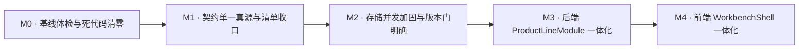

# 03 · 分阶段落地路线图与验收门禁

本路线图将 [一体化框架总体蓝图](./01-blueprint.md) 与 [核心接口与扩展点规范](./02-contracts-and-extensions.md) 拆解为 **5 个低风险、可独立验收、每阶段结束均保持全量绿灯的可交付里程碑（M0–M4）**。

---

## 一、分阶段实施清单与验收门禁

### 阶段 M0 · 工程基线体检与死代码清零

- **核心目标**：摸清当前 TypeScript 编译状态，清除阻碍一体化收口的历史双套客户端残留代码。
- **具体改造动作**：
  1. 执行 `npm ci --ignore-scripts`，实测当前 `npm run verify` 与 `npm run build` 的基线结果；
  2. **删除孤立的 9 个客户端文件**：`src/client/workbench.ts` 与 `src/client/app/` 全部文件（共 2,321 行未接线代码）；
  3. 同步收紧 [tsconfig.json](../../tsconfig.json) 与 [tsconfig.build.json](../../tsconfig.build.json) 的 `exclude` 范围；
  4. 将 [scripts/dev-server.mjs](../../scripts/dev-server.mjs) 默认 `HOST` 收紧为 `"127.0.0.1"`（仍允许通过 `process.env.HOST` 覆盖）。
- **验收门禁**：
  - `npm run check`（`noEmit`）零报错通过；
  - `npm run build` 成功，且检查 `dist/` 目录不再出现 `client/app/` 死产物；
  - `npm run test:all` 全量 **343/343** 通过。

---

### 阶段 M1 · 契约单一真源与静态清单收口

- **核心目标**：消除 DTO 类型双源与静态 JS 路由三处硬编码，补齐入口边界校验微瑕。
- **具体改造动作**：
  1. 合并原 `src/contracts/workspace.ts` 与 `src/client/workbench/types.ts` 为单一 DTO 源（[src/contracts/workspace-dto.ts](../../src/contracts/workspace-dto.ts)），供应用层、宿主与浏览器端共用；
  2. 新增 `src/client/manifest.ts` 统一维护客户端静态 HTML/CSS/JS 模块清单，替换 `src/host/plugin.ts`、`scripts/dev-server.mjs` 与 `scripts/browser-check.mjs` 三处的重复硬编码数组；
  3. 补齐边界防线：在 `fanqie-service.ts` 的 `evidence.record` 增加 `row.product === "fanqie"` 校验；在 `author-workspace.ts` 创建番茄章节时不再借用 `toutiao.validateArticleTitle`。
- **验收门禁**：
  - `npm run verify` + `npm run build` 全部通过；
  - `npm run test:browser`（Playwright 三旅程验收）通过，确认客户端模块清单在宿主路由与浏览器测试中 100% 一致。

---

### 阶段 M2 · 存储并发加固与 Schema 版本门明确化

- **核心目标**：消除 SQLite 多连接下的隐式升级锁与旧库升级歧义，确保长期生产安全运行。
- **具体改造动作**：
  1. 在 [src/host/plugin.ts](../../src/host/plugin.ts) 与 [scripts/dev-server.mjs](../../scripts/dev-server.mjs) 打开文件数据库时统一启用 `PRAGMA journal_mode = WAL;`；
  2. 为 [src/application/context.ts](../../src/application/context.ts) 的 `ROLLBACK` 补充 `try/catch` 保护；
  3. 解除 `read.model` / `evidence.detail` 在 `BEGIN` 只读事务内写 `author_read_checkpoints` 的锁升级冲突（读前/读后显式分离只读查询与检查点持久化写事务，或对带落盘的读模型推进使用 `BEGIN IMMEDIATE`）；
  4. 明确并固化 `zhizhang/2.0` 旧库兼容性策略：若决定接纳重构前 `2.0.0` 旧库，则补齐幂等列检查与回填迁移；若保持洁净表结构，则同步更新 `SCHEMA_ID` 并明确拒开旧库报错细节。
- **验收门禁**：
  - 在 `test/workspace-v2.test.mjs` 新增「多 SQLite 连接并发写入 + 增量读模型查询不触发 `SQLITE_BUSY`」用例与「旧版库升级/拦截」用例；
  - `npm run test:all` 全量通过。

---

### 阶段 M3 · 后端一体化：`ProductLineModule` 注册化与宿主去领域化

- **核心目标**：将后端应用层、只读模型引擎与 `host/writing.ts` 彻底按「单底座 + 双隔离产品线模块」收口。
- **目录放置建议（对齐 [AGENTS.md](../../AGENTS.md) 边界）**：
  - 为不打破 `AGENTS.md` 既定的 `contracts/`、`domain/`、`storage/`、`workflow/`、`application/`、`host/`、`client/`、`bundle/` 顶层目录划分，推荐在 `src/application/` 下直接收口为 `products/fanqie/` 与 `products/toutiao/`（均只依赖各自对应 `domain/*`、共享 `domain/shared`、`workflow/`、`storage/` 与 `contracts/`，互不导入），由 `author-workspace.ts` 持有静态注册表 `[fanqieModule, toutiaoModule]`。
- **具体改造动作**：
  1. 定义 `ProductLineModule` 与 `ProductLineRegistry` 接口，改造 `context.ts` 支持动态锁定态集合与注册扩展表初始化；
  2. 将 `author-workspace.ts` 的 31 分支 `switch` 拆分为「底座 13 个通用动作 + `registry.dispatchAction` 路由至产品线 18 个专属动作」；
  3. 解耦 `run-service.ts` 与 `snapshot-service.ts`：通过 `buildFrozenContext`、`onCandidateCreated` 与 `contributeSnapshot` 消除全部双线硬编码；
  4. **收口 `src/host/writing.ts`**：退回为纯 `SingleShotLlmCaller`（删除对 `domain/toutiao` 的导入），将头条 `autoQa`（`qa → refine × ≤2`）迁移回头条产品线模块的 `runGeneration` 管线；
  5. 解耦 `src/workflow/author-reads.ts`：底座引擎负责 `navigation` / `revision-candidate` / `run` 三类通用读模型与持久化检查点机制，由产品线模块向其注入 `settings-view`、`evidence` 与 `approval-history` 归约单元。
- **验收门禁**：
  - 在 `test/refactor-v2.test.mjs` 与 `test/smoke.test.mjs` 补齐「宿主零领域导入」「底座零产品分支」「双线零交叉」静态断言；
  - `node scripts/model-check.mjs`（3000 字长图文 + QA + 回改 + 超预算 + 缺失回执）通过；
  - `node scripts/workspace-bench.mjs`（650 章万字 `< 100 KiB` / 100 条历史 `< 150 KiB`）达标；
  - `npm run test:all` 全量通过。

---

### 阶段 M4 · 前端一体化：`WorkbenchShell` 与双线 UI 模块拆分

- **核心目标**：拆分 1,130 行单体 `main.ts`，使浏览器端严格对齐后端双线隔离结构，并保持全部既有交互零退化。
- **具体改造动作**：
  1. 定义 `WorkbenchShellHost` 与 `ProductLineUiModule` 契约，将 `src/client/workbench/main.ts` 拆分为底座 `shell.ts` 与两个隔离插件 `plugins/fanqie.ts`、`plugins/toutiao.ts`；
  2. 更新 `src/client/manifest.ts` 与 `tsconfig.client.json` 确保全部新模块进入静态路由清单与客户端编译输出；
  3. 保持 `workbench.html` 与 `workbench.css` 选择器、`DraftVault` 慢保存协议、`<dialog>` 模态框、`DiffView` 与 `RunInspector` 语义完全不变。
- **验收门禁**：
  - `npm run verify && npm run test:all && npm run build` 全部通过；
  - `npm run test:browser` 三条端到端浏览器旅程一次通过且 `pageerror` 为空；
  - 执行 `npm pack --ignore-scripts`，在 DsH Web `0.2.2-rc.4` 隔离 profile 完成安装、双入口挂载、端到端操作与卸载验证。

---

## 二、阶段汇总与验证红线矩阵

| 阶段 | 状态 | 核心产出 | 必跑验证门禁 | 实际文件变更范围 |
| --- | :---: | --- | --- | --- |
| **M0** | **已完成** | 清除双套客户端分叉 | `check` + `build` + `test:all` (343/343) | 删除 `workbench.ts` 与 `client/app/*`，收紧 `dev-server.mjs` 默认 `HOST` |
| **M1** | **已完成** | 单一 DTO 与静态清单 | `verify` + `build` + 静态清单检查 | 收口 [workspace-dto.ts](../../src/contracts/workspace-dto.ts)、[manifest.ts](../../src/client/manifest.ts) 与 `tsconfig.client.json` |
| **M2** | **已完成** | WAL、锁升级修复与旧库平滑升级 | `verify` + `test:all` (345/345) | `storage/author-schema.ts`、`application/context.ts`、`host/plugin.ts`、`workflow/author-reads.ts` |
| **M3** | **已完成** | 后端 `ProductLineModule` | `verify` + `test:all` + `model-check` + `workspace-bench` + 静态守卫 | [product-line.ts](../../src/application/product-line.ts)、`application/products/*`、`host/writing.ts`、`workflow/author-reads.ts` |
| **M4** | **已完成** | 前端 `WorkbenchShell` 拆分 | `verify` + `test:all` + `build` + `npm pack --dry-run` + 静态守卫 | [shell.ts](../../src/client/workbench/shell.ts)、`src/client/workbench/plugins/*`、[main.ts](../../src/client/workbench/main.ts) |

---

## 三、演进验证：未来接入第三条产品线的标准路径

通过 M0–M4 收口后，底座不预先堆砌泛化插件框架，但已具备清晰稳定的静态接入形态。如未来作者授权新增第三条创作线，只需按以下 **5 步静态清单** 接入即可，无需改造底座基础设施：

1. 在 `src/domain/<product>/` 建立完全独立的产品领域纯规则模块；
2. 在 `src/contracts/workspace-dto.ts` 联合类型扩展产品标识、状态词与动作名；
3. 在 `src/application/products/<product>/` 实现 `ProductLineModule` 接口并在 `author-workspace.ts` 注册表登记；
4. 在 `src/client/workbench/plugins/<product>.ts` 实现 `ProductLineUiModule` 4 个 UI 槽位并登记到 `shell.ts` 与 `src/client/manifest.ts`；
5. 在 `test/` 为该产品线补充独立合规测试，并由自动化依赖边界守卫校验与其他产品线零交叉引用。
